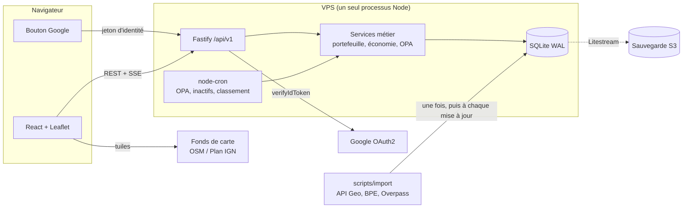

# 2. Analyse des besoins et stack technique

## 2.1 Les besoins et leur réponse technique

| Besoin | Conséquence technique | Réponse |
|---|---|---|
| Connexion uniquement par Google | Pas de mot de passe à stocker | Google Identity Services (bouton) → jeton d'identité vérifié côté serveur → session en cookie |
| Seulement les communes françaises (Métropole + Outre-mer) | La liste des communes achetables vient d'une source officielle, le serveur refuse le reste | Import de l'**API Geo** (`geo.api.gouv.fr`) dans SQLite ; tout achat vérifie que le code INSEE existe dans `territories` |
| ~35 000 communes sur une carte web | Impossible d'afficher tous les contours d'un coup | Contours **simplifiés à l'import**, servis **par écran visible** (index spatial R*Tree) et seulement à partir du zoom 9 |
| Prix et revenus tirés de la réalité | Données de population et d'équipements par commune | Population (API Geo/INSEE) + équipements (**INSEE BPE**) + gares, monuments, attractions (**OpenStreetMap / Overpass**) |
| Revenus même hors ligne | Pas de minuterie par joueur | **Calcul différé** : à chaque requête, revenu = débit × temps écoulé depuis `income_collected_at` (plafonné à 24 h) |
| OPA de 24 h, libération des inactifs | Des actions à heure fixe, même si personne n'est connecté | **Tâches planifiées** (`node-cron`) **+ vérification à la requête** (une OPA expirée est résolue dès qu'on la lit) |
| Économie juste, sans triche | Le client ne doit rien décider | Toutes les règles **côté serveur**, en **transactions SQLite** ; montants **entiers** ; journal `wallet_transactions` en ajout seul |
| Monétisation plus tard | Ne pas avoir à tout refaire | Deux devises séparées dès la V1 (`cash`, `premium_currency`), tables boutique et paiements déjà créées mais désactivées |
| Deux développeurs | Travailler en parallèle sans se bloquer | Monorepo `frontend/` + `backend/` + `shared/` ; contrat d'API (schémas zod) écrit **avant** chaque sprint dans `shared/` |

## 2.2 Stack choisie

| Couche | Choix | Pourquoi |
|---|---|---|
| Langage | **TypeScript** partout | Un seul langage pour le duo ; types partagés front/back |
| Monorepo | **npm workspaces** (`frontend`, `backend`, `shared`) | Rien à installer de plus que Node |
| Frontend | **Vite + React 19** | Démarrage instantané, écosystème carte mûr |
| Carte | **Leaflet 1.9 + react-leaflet**, rendu **canvas** (`preferCanvas`) | Demandé ; le canvas tient des milliers de polygones |
| État front | **TanStack Query** (données serveur) + **Zustand** (état d'interface) | Cache, rafraîchissement, peu de code |
| Style | **Tailwind CSS** | Rapide à deux, pas de CSS qui diverge |
| Tutoriel | **driver.js** | Met en avant un élément de l'écran étape par étape (ancres `data-tuto="..."`) |
| Backend | **Node.js LTS (≥ 22) + Fastify 5** | Rapide, validation par schéma intégrée, logs Pino |
| Validation | **zod** (schémas dans `shared/`) | Le même schéma valide le formulaire front et la requête back |
| Base | **SQLite** via **better-sqlite3** | Synchrone et transactionnel : idéal pour une économie (pas de « course » entre deux requêtes) |
| Auth | **google-auth-library** (`verifyIdToken`) | Vérification officielle du jeton Google |
| Tâches planifiées | **node-cron** (fuseau `Europe/Paris`) | Dans le même processus que l'API, pas d'infrastructure en plus |
| Temps réel | **Server-Sent Events** (`GET /api/v1/events`) | Notifications d'OPA sans WebSocket |
| Tests | **Vitest** (unitaires), **node:test** (schéma SQL, déjà en place), **Playwright** (bout en bout, Sprint 6) | |
| Qualité | **Biome** (lint + format en un outil) | Une seule config pour le duo |
| Hébergement | **Un VPS** (ex. 2 vCPU / 4 Go) + **Caddy** (HTTPS auto) + **Litestream** (sauvegarde continue de SQLite) | SQLite = un seul serveur, c'est voulu et suffisant pour des milliers de joueurs |

> SQLite est utilisée en mode **WAL** (lecteurs et écrivain en parallèle), `foreign_keys = ON`, `busy_timeout = 5000`, `synchronous = NORMAL`. Toutes les écritures passent par `db.transaction(...)` de better-sqlite3 (`BEGIN IMMEDIATE`).

## 2.3 Vue d'ensemble



## 2.4 Données géographiques : import et cache

Les communes ne changent presque jamais : on les **importe une fois** dans SQLite (puis une fois par an, au 1er janvier, quand l'INSEE publie les fusions de communes). Le jeu ne dépend donc **jamais** d'une API externe pendant qu'on joue.

### Sources

| Donnée | Source | Couverture | Licence |
|---|---|---|---|
| Code INSEE, nom, département, région, population, surface, centre, **contour** | API Geo `geo.api.gouv.fr/communes` | Métropole, DROM **et** COM (vérifié : 975, 977, 978, 986, 987, 988 répondent, contours compris) — **34 969 communes** au 15/11/2026 | Licence Ouverte 2.0 |
| Équipements (commerces, santé, écoles, sport, hôtels...) | **INSEE BPE** (Base permanente des équipements, CSV) | Métropole + DROM | Licence Ouverte 2.0 |
| Gares, aéroports, ports, monuments, musées et attractions | **OpenStreetMap** via Overpass | Partout, y compris COM (où la BPE n'existe pas) | ODbL : attribution « © les contributeurs d'OpenStreetMap » obligatoire |

Exclus en V1 : les districts des **TAAF** (984) et **Clipperton** (989) — pas d'habitants, pas de vraies communes. Ils pourront revenir plus tard sous forme d'« expéditions » (événement spécial).

### Pipeline `scripts/import/` (Sprint 1 et 2)

1. **communes** : pour chaque code département (liste de `/departements` + COM `975, 977, 978, 986, 987, 988`), appel
   `GET /communes?codeDepartement=XX&fields=nom,code,codeDepartement,codeRegion,population,surface,centre,contour&format=geojson&geometry=contour`.
   Une requête par seconde, réponses brutes gardées dans `data/raw/` (ignoré par Git) pour ne pas re-télécharger.
2. **simplification** : deux versions de chaque contour (`geojson_low` pour zoom 9–10, `geojson_high` pour zoom ≥ 11) avec `@turf/simplify` ; calcul de la boîte englobante → `territories_rtree`.
3. **zone** : `zone_code` déduit du département (`971 → GP`, `972 → MQ`, `973 → GF`, `974 → RE`, `976 → YT`, `975 → PM`, `977 → BL`, `978 → MF`, `986 → WF`, `987 → PF`, `988 → NC`, sinon `MET`) ; `region_type = 'outre_mer'` si code ≥ 971.
4. **bpe** : téléchargement du CSV BPE, agrégation par commune et par catégorie → `territory_stats (source = 'bpe')`.
5. **osm** : une requête Overpass par département (`out count;` par catégorie), avec pause entre requêtes → `territory_stats (source = 'osm')`. Pour un import complet plus rapide, alternative : extrait France de Geofabrik + `osmium`.
6. **valeurs** : calcul de `infra_score`, `base_value` (V0) et `building_slots` avec les formules de [05-equilibrage.md](05-equilibrage.md) (importées depuis `shared/`), et `balance_version`. Rejouable à tout moment sans toucher aux propriétaires.
7. **sorties pour le front** : `frontend/public/geo/departements.json` (contours très simplifiés pour les zooms < 9) et `shared/src/zones.ts` (boîte et zoom de chaque zone, calculés depuis les contours).

Volumes attendus (à mesurer au Sprint 1) : quelques dizaines de Mo pour les contours simplifiés, ~35 000 lignes de territoires.

## 2.5 Carte verrouillée sur la France

- **Rien d'étranger n'est cliquable** : seules les communes importées sont dessinées et cliquables. Le fond de carte montre les pays voisins, mais un **masque gris** (polygone inversé) les estompe.
- **Sélecteur rapide** : Métropole, Corse, Guadeloupe, Martinique, Guyane, La Réunion, Mayotte, Saint-Pierre-et-Miquelon, Saint-Barthélemy, Saint-Martin, Wallis-et-Futuna, Polynésie, Nouvelle-Calédonie. Choisir une zone fait `flyToBounds` puis applique `maxBounds` de cette zone (on ne peut pas « glisser » jusqu'en Espagne).
- **Niveaux de zoom** : < 9 = départements (fichier statique) et marqueurs des propriétés du joueur ; ≥ 9 = communes de l'écran (`GET /api/v1/map/territories?bbox=...&zoom=...`), colorées selon l'état : libre, à moi, à un rival, OPA en cours, bouclier.
- **Côté serveur**, l'achat refuse tout code INSEE absent de `territories` (code d'erreur `TERRITORY_NOT_FOUND`) : même un client modifié ne peut pas acheter hors de France.

### Fonds de carte

- Développement : tuiles OpenStreetMap standard (`tile.openstreetmap.org`), avec attribution.
- Production : la politique d'usage d'OSM interdit le trafic d'une application à fort trafic sur ses serveurs. Utiliser **Plan IGN** (Géoplateforme `data.geopf.fr`, gratuit, couvre l'Outre-mer) ou un fournisseur de tuiles OSM (MapTiler, Stadia, auto-hébergement PMTiles). Le choix est une simple URL dans `.env`.

## 2.6 Tâches planifiées et vérification à la requête

Chaque règle temporelle a **deux** garde-fous : une tâche planifiée (pour que ça arrive même si personne ne se connecte) et une vérification au moment où la donnée est lue (pour que ce soit exact à la seconde près). Les deux appellent la **même fonction**, idempotente, dans une transaction.

| Tâche | Fréquence | Ce qu'elle fait |
|---|---|---|
| `resolve-takeovers` | toutes les minutes | OPA `pending` dont `expires_at` est passé → transfert du territoire (voir 05) |
| `release-inactive` | chaque jour à 04:00 | Joueurs sans activité depuis 14 jours → territoires libérés, rachat par l'État, OPA annulées, statut `dormant` |
| `warn-inactive` | chaque jour à 04:05 | Notification « tes territoires seront libérés dans 3 jours » (visible au retour ; e-mail possible en V2) |
| `leaderboard` | toutes les 10 min | Recalcule `users.net_worth` et `rank_level` |
| `cleanup` | chaque jour à 05:00 | Sessions expirées, notifications lues de plus de 30 jours |

- Les chantiers terminés, les boucliers et les quêtes du jour **n'ont pas besoin de tâche** : ils se calculent à la lecture à partir des dates.
- Chaque exécution laisse une ligne dans `job_runs` ; l'index unique `uq_job_runs_one_running` empêche deux exécutions simultanées.
- Si un jour il faut plusieurs serveurs, ces tâches passent dans un processus « worker » séparé ; rien d'autre ne change.

## 2.7 Sécurité

- **Session** : jeton aléatoire de 32 octets dans un cookie `HttpOnly; Secure; SameSite=Lax` ; en base, seulement son **hachage SHA-256** (`sessions.id`). Durée 30 jours, prolongée à l'usage.
- **CSRF** : toutes les requêtes qui modifient quelque chose doivent avoir un en-tête `Origin` égal à `APP_ORIGIN`.
- **Limitation de débit** : `@fastify/rate-limit` (ex. 120 requêtes/min par joueur, 10/min sur `/auth`).
- **Idempotence** : les actions qui coûtent de l'argent acceptent un en-tête `Idempotency-Key` ; il devient `wallet_transactions.idempotency_key` (unique) : un double-clic ne paie jamais deux fois.
- **Multi-comptes** : un compte par compte Google ; il faut 7 jours d'ancienneté pour lancer une OPA ; alerte admin si deux comptes s'échangent souvent des territoires.
- **RGPD** : on ne garde que l'identifiant Google, l'e-mail, le pseudo et l'avatar. Suppression de compte = **anonymisation** (le journal financier doit rester cohérent). Pages « Confidentialité » et « Mentions légales » au Sprint 6.

## 2.8 Organisation du code

```
france-tycoon/
├── frontend/            React + Leaflet (Dev B)
│   └── src/  map/  panels/  hud/  tutorial/  api/
├── backend/             Fastify + SQLite (Dev A)
│   └── src/
│       ├── db/          migrations/*.sql, connexion, schema.test.mjs
│       ├── modules/     auth/ map/ territories/ buildings/ takeovers/ quests/ tutorial/ leaderboard/ wallet/
│       ├── jobs/        tâches planifiées
│       └── server.ts
├── shared/              à deux : types, schémas zod, formules d'équilibrage, zones
├── scripts/import/      import des communes et des équipements
├── data/                données brutes téléchargées (ignorées par Git)
└── docs/                ce dossier
```
