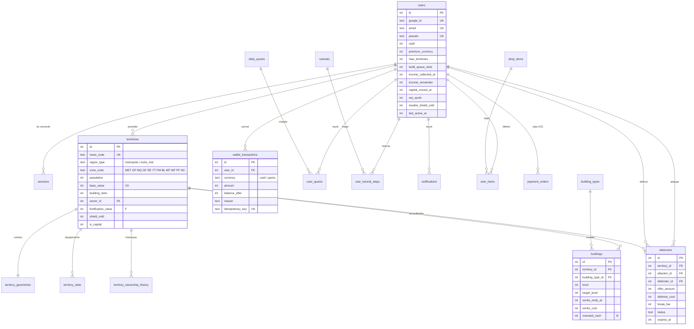

# 3. Base de données (SQLite)

Le schéma exact, exécutable, est dans le code :

- [`backend/src/db/migrations/001_initial.sql`](../backend/src/db/migrations/001_initial.sql) — 19 tables `STRICT`, index, déclencheurs
- [`backend/src/db/migrations/002_seed.sql`](../backend/src/db/migrations/002_seed.sql) — catalogues : bâtiments, tutoriel, quêtes, boutique
- [`backend/src/db/migrations/003_economie_etape3.sql`](../backend/src/db/migrations/003_economie_etape3.sql) — étape 3 : bâtiments à 5 niveaux et gare, prix du chantier (`works_cost`), 4 territoires au départ
- [`backend/src/db/migrations/004_reste_revenus.sql`](../backend/src/db/migrations/004_reste_revenus.sql) — étape 3 : reste des revenus (`income_remainder`), pour ne perdre aucune fraction de ₮
- [`backend/src/db/migrations/005_deplacement_capitale.sql`](../backend/src/db/migrations/005_deplacement_capitale.sql) — étape 3 : date du dernier déplacement de capitale (`capital_moved_at`), pour la limite d'une fois tous les 7 jours
- [`backend/src/db/schema.test.mjs`](../backend/src/db/schema.test.mjs) — 30 tests (`node --test backend/`), lancés par la CI à chaque push

> Cette page explique le schéma. En cas de doute, **le fichier SQL fait foi**.

## 3.1 Conventions

| Règle | Détail |
|---|---|
| Tables `STRICT` | SQLite refuse un texte dans une colonne entière (testé) |
| Dates | `INTEGER`, secondes Unix UTC, `unixepoch()` par défaut. Le fuseau `Europe/Paris` ne sert qu'à l'affichage et au « jour » des quêtes |
| Argent | `INTEGER` uniquement. `cash` = monnaie de jeu, `premium_currency` = gemmes |
| Clés | `id INTEGER PRIMARY KEY` (alias du rowid) ; codes métier en `UNIQUE` (`insee_code`, `code`, `sku`) |
| Énumérations | `CHECK (col IN (...))` : la base refuse une valeur inconnue |
| Migrations | fichiers numérotés, **jamais modifiés** une fois fusionnés |

## 3.2 Schéma relationnel



## 3.3 Les tables, une par une

### Joueurs

**`users`** — un joueur = un compte Google.
- Identité : `google_id` (le `sub` du jeton), `email`, `pseudo` (unique, insensible à la casse, 3–24 caractères), `avatar_url`.
- Portefeuille : `cash ≥ 0`, `premium_currency ≥ 0` (la base refuse un solde négatif).
- Limites : `max_territories` (1–12), `extra_territory_slots` (0–1, boutique V2), `build_queue_slots` (1–3), `rank_level`. `max_territories` est recalculé à chaque chantier fini (siège social : +1 par niveau, `buildings/limites.ts`). La création de compte écrit elle-même `max_territories = 4` et `build_queue_slots = 1` (`TERRITOIRES_DEPART`, `FILES_CONSTRUCTION_DEPART` de balance.ts) : la valeur par défaut de la colonne (3, migration 001) date d'avant l'étape 3 ; la migration 003 a donné +1 aux joueurs déjà inscrits.
- Économie : `income_collected_at` (point de départ du calcul des revenus hors ligne), `income_remainder` (0 à 3 599 : la fraction de ₮ pas encore versée, en ₮ × secondes, migration 004), `net_worth` (patrimoine en cache pour le classement).
- Capitale : `capital_moved_at` (NULL = jamais déplacée ; construire le siège ne compte pas comme un déplacement, migration 005). Prochain déplacement possible 7 jours après.
- Protection : `newbie_shield_until` = inscription + 72 h.
- Index : `(status, last_active_at)` pour la tâche d'inactivité ; `net_worth DESC` (joueurs actifs) pour le classement.

**`sessions`** — `id` = SHA-256 du jeton du cookie (jamais le jeton lui-même), `expires_at`, `last_seen_at`.

### Territoires

**`territories`** — une ligne par commune française importée.
- Géographie : `insee_code` (5 caractères), `department_code`, `region_code`, **`region_type`** (`metropole` / `outre_mer`), **`zone_code`** (12 zones autorisées, la base refuse le reste), `population`, `area_km2`, centre.
- Valeurs calculées à l'import : `infra_score` (I), `base_value` (V0), `building_slots`, `balance_version`.
- Saisons (migration 017) : `season_profile` (`littoral` / `montagne` / `rural`, ou `NULL`) dit quelle saison profite à la commune ([05](05-equilibrage.md) § 5.12). Vide pour l'instant : il viendra d'un import.
- Propriété : `owner_id` (NULL = libre), `acquired_at`, `acquired_price`, `fortification_value` (F, gagnée en défendant une OPA), `shield_until`, `is_capital` (héberge le siège social, immunisé contre les OPA ; une seule capitale par joueur grâce à un index unique partiel).

**`territory_geometries`** — contours GeoJSON `geojson_low` / `geojson_high`, séparés pour garder `territories` légère.

**`territories_rtree`** — table virtuelle R*Tree : boîte englobante de chaque commune. Requête type :

```sql
SELECT t.id, t.insee_code, t.name, t.owner_id, g.geojson_low
FROM territories_rtree r
JOIN territories t ON t.id = r.id
JOIN territory_geometries g ON g.territory_id = t.id
WHERE r.max_lng >= :west AND r.min_lng <= :east
  AND r.max_lat >= :south AND r.min_lat <= :north
LIMIT 3000;
```

**`territories_fts`** — recherche plein texte FTS5, insensible aux accents (« saint etienne » trouve « Saint-Étienne »), tenue à jour par 3 déclencheurs.

**`territory_stats`** — nombre d'équipements par commune, catégorie et source (`bpe` ou `osm`). Sert au calcul de I.

**`territory_ownership_history`** — chaque changement de propriétaire (achat, vente, OPA, inactivité, admin), avec le prix.

### Bâtiments

**`building_types`** — catalogue (7 types en V1 : résidence, commerce, usine, quartier d'affaires, équipement public, gare, siège social ; niveau 5 au maximum). Contient tous les paramètres d'équilibrage : coût, croissance du coût, revenu, bonus en %, temps de construction, niveau max, emplacements occupés, limites par territoire et par joueur, population minimale. Valeurs de 002, remplacées par 003 (docs/05, 5.2) ; servies telles quelles par `GET /building-types`.

**`buildings`** — un bâtiment posé sur un territoire.
- `level` = niveau **actif** (0 pendant la toute première construction).
- Chantier en cours : `target_level = level + 1`, `works_ends_at` et `works_cost` renseignés (la base impose les trois ensemble, et interdit de sauter un niveau).
- `works_cost` = prix payé pour le chantier en cours (> 0) : une annulation rend exactement ce montant, même si f_T a changé depuis (nouvel import).
- `invested_cash` = total dépensé (B), chantier en cours compris ; compte dans la valeur du territoire.
- Pas de colonne « propriétaire » : c'est celui du territoire (les bâtiments suivent le territoire lors d'une OPA).

### PvP

**`takeovers`** — une OPA.
- Montants **figés au lancement** : `territory_value`, `offer_amount` (bloqué chez l'attaquant), `defense_cost`, `break_fee`.
- `status` : `pending` → `defended` | `accepted` | `succeeded` | `cancelled` | `voided`. La base impose `resolved_at` dès que ce n'est plus `pending`.
- Index unique partiel : **une seule OPA en cours par commune**. Index sur `expires_at` (OPA en attente) pour la tâche de résolution, et sur `(attacker_id, defender_id, created_at)` pour le délai anti-acharnement.

### Portefeuille

**`wallet_transactions`** — le journal d'audit de **tous** les mouvements de cash et de gemmes.
- `amount` signé, `balance_after` (solde après l'opération : permet de vérifier le solde à tout moment), `reason` (liste fermée), `ref_type` / `ref_id` (l'objet concerné), `idempotency_key` unique, `metadata` JSON.
- **En ajout seul** : deux déclencheurs refusent `UPDATE` et `DELETE`. Une erreur se corrige par une nouvelle ligne (`admin_adjustment`).
- Règle applicative : **une seule fonction** modifie un solde, `wallet.apply(tx, { userId, currency, amount, reason, ref, idempotencyKey })`, qui met à jour `users` et écrit le journal dans la même transaction.

### Rétention

**`tutorials`** + **`user_tutorial_steps`** — 10 étapes ; chacune dit quel élément mettre en avant (`ui_anchor`), quel événement la valide (`completion_event`) et qui la valide (`server` pour les actions de jeu, `client` pour « j'ai zoomé »).

**`daily_quests`** (catalogue) + **`user_quests`** — 3 quêtes par joueur et par jour (`slot` 1 = facile, 2 = moyenne, 3 = difficile). La récompense est figée au tirage. Contraintes : une quête ne sort pas deux fois le même jour, pas de 4ᵉ quête, pas de réclamation avant d'avoir fini. `seen_refs` (migration 006) : ce qui a déjà compté pour la quête (commune, zone, heure d'encaissement), en tableau JSON. Une quête réussie écrit un message `kind = 'quest_completed'` (`contenuQueteTermineeSchema`, shared/src/api/notifications.ts).

**`user_state_projects`** (migration 016) — appel à projets de l'État : une ligne par joueur et par semaine (`week` = lundi `AAAA-MM-JJ`, heure de Paris ; `UNIQUE (user_id, week)`), créée à sa première action qui compte. `project_code` garde le projet de la semaine (liste `APPELS_A_PROJETS` dans `shared/src/balance.ts`, pas de table catalogue). Réussi : `completed_at`, `reward_cash` et `reward_gems` figés, prime versée en `quest_reward` (`ref_type = 'state_project'`). Règles : [05](05-equilibrage.md) § 5.11.

**`notifications`** — OPA reçue, OPA résolue, chantier fini, alerte d'inactivité. OPA : `takeover_received` (au défenseur, au lancement), `takeover_resolved` (à l'autre joueur à chaque issue ; aux deux pour `succeeded`). Inactivité : `inactivity_warning` (J+11, une fois par absence), `inactivity_released` (J+14, nombre de territoires et total racheté). Index partiel sur les non lues. Chantier fini : `kind = 'building_done'`, `payload` au format `chantierFiniSchema` (shared/src/api/economie.ts), `created_at` = date de fin du chantier ; écrit par l'encaissement (`backend/src/modules/income/revenus.ts`).

### Monétisation V2 (créée, inactive)

- **`shop_items`** : skins de marqueurs, 2ᵉ file de construction, boost de revenus temporaire, emplacement de territoire. `is_active = 0` partout en V1. Les objets « de puissance » ont aussi un prix en cash.
- **`user_items`** : objets possédés, `expires_at` pour les boosts, `is_equipped` pour les skins.
- **`payment_orders`** : commandes Stripe (V2). Le webhook Stripe créditera les gemmes via `wallet.apply(..., reason: 'gems_purchase')`.

### Exploitation

**`job_runs`** — journal des tâches planifiées + verrou (une seule exécution `running` par tâche).

**`roadmap_features`** (migration 009) — la feuille de route publique (page `/roadmap`, `GET /roadmap`). `code` unique (`intercommunalite`, `jumelage`, `saisons`, `gemmes`, `aleas`), `position` = ordre d’affichage, `category` (`social`, `gameplay`, `economy`), `status` (`planned` Prévu, `in_progress` En cours, `released` Déployé), `details` = tableau JSON de textes. Remplie par la migration elle-même, rejouable sans doublon (`ON CONFLICT (code) DO NOTHING`). Changer un statut ou un texte : nouvelle migration avec un `UPDATE`. Table seule, sans lien avec les autres.

### Dashboard /admin (migrations 010 à 015)

**`staff_roles`** (010) — grade de l'équipe : `role` `moderator` ou `admin`, `granted_by`, `granted_at`. Un joueur sans ligne n'a pas de grade. Les e-mails de `ADMIN_EMAILS` (`.env`) sont admin d'office, sans ligne ici. `users.role` (ancien) n'est pas lu.

**`users.suspended_until`, `users.suspension_reason`** (011) — suspension : jusqu'à cette date, le joueur lit mais toute écriture répond 403 `ACCOUNT_SUSPENDED` avec le motif (`auth/requete.ts`).

**`staff_notes`** (011) — notes de l'équipe sur un joueur (1 à 2 000 caractères), effacées avec le compte.

**`login_events`** (011) — une ligne par connexion : `ip_hash` et `ua_hash` = sha256(`IP_SALT` + valeur), 16 caractères. Jamais d'IP en clair ; rien n'est noté si `IP_SALT` est vide. Lignes de plus de 90 jours effacées à chaque connexion.

**`territories.forced_price`** (012) — prix d'achat forcé par un admin (> 0) ; `NULL` = calcul auto (V0). Le motif est dans `admin_audit` (`territory.price`).

**`site_status`** (013) — une seule ligne (`id = 1`) : `maintenance_message` (3 à 300 caractères ; `NULL` = pas de maintenance), `banner_text` et `banner_until` (bannière d'annonce ; `until NULL` = sans fin). Lue par `GET /status` et le crochet de `auth/requete.ts`.

**`player_reports`** (013) — « Signaler un bug » : `body` (10 à 2 000), `page` (chemin de la page, 200 max), `status` `open` → `in_progress` → `resolved` ou `rejected`, `staff_note` (vue de l'équipe seulement). `user_id` passe à `NULL` si le compte est supprimé.

**`live_config`** (014) — réglages à chaud permanents, une ligne par changement (ajout seul) : `price_pct`, `income_pct`, `building_pct` (25 à 400 ; 100 = normal), `reason`, `created_by`, `starts_at` (jamais dans le passé). La plus récente déjà commencée s'applique ; aucune ligne = tout à 100 %.

**`game_events`** (014) — événements datés : `title` (3 à 80), les trois `*_pct`, `starts_at`, `ends_at` (fin automatique), `cancelled_at` (arrêt avant la fin ; le passé ne change pas). Leurs % multiplient ceux de `live_config` pendant `[starts_at ; min(ends_at, cancelled_at))`. On ne modifie pas un événement : on l'arrête et on en crée un autre. Les deux tables gardent tout : les revenus non encaissés se calculent par morceaux avec elles (docs/05 § 5.10).

**`cheat_reviews`** (015) — alertes anti-triche classées par l'équipe : `alert_key` (règle + faits), `note`, `reviewed_by`, `reviewed_at`. Les alertes elles-mêmes ne sont pas stockées : le serveur les recalcule à chaque lecture depuis `login_events`, `wallet_transactions` et `takeovers` (docs/04). Index ajoutés sur `wallet_transactions` : `(user_id, currency)` pour retrouver le mouvement précédent, `(created_at)` pour le journal et les graphiques.

**`app_errors`** (015) — erreurs 500 de l'API : `method`, `route` (le modèle, sans paramètres ni requête), `message` (500 caractères au plus). On garde les 1 000 dernières.

**`admin_audit`** (011) — journal des actions de l'équipe : qui (`actor_*`, recopiés), quoi (`action`, `target_type`, `target_id`), `before_json` / `after_json`, `reason`. **En ajout seul** : des déclencheurs refusent `UPDATE` et `DELETE`. Pas de clé étrangère, pour qu'une ligne ne bouge jamais.

## 3.4 Ce que la base garantit, ce que le code garantit

| Garanti par SQLite (testé) | Garanti par le code (à tester aux étapes 3–4) |
|---|---|
| Solde jamais négatif | Limite de territoires (`max_territories`) |
| Commune hors des 12 zones refusée | Emplacements de bâtiments disponibles |
| Une seule OPA en cours par commune | Bouclier, protection débutant, délai de 7 jours entre deux OPA du même attaquant sur le même défenseur |
| Pas d'OPA sur soi-même | Capitale immunisée |
| Journal financier inaltérable, pas de double paiement | Tout mouvement d'argent passe par `wallet.apply` |
| Une capitale max par joueur | Un seul siège social par joueur |
| Chantier cohérent (pas de saut de niveau) | Une seule file de construction (2ᵉ et 3ᵉ achetables plus tard) |

## 3.5 Exploitation

- **Sauvegarde** : Litestream réplique le fichier WAL en continu vers un stockage S3 ; restauration testée à l'étape 6. En ligne, c'est la copie chiffrée horaire sur Google Drive qui sert (`sauvegarde-drive.sh`).
- **Copies du dashboard** (étape 5) : bouton « Sauvegarder maintenant » (admins) → copie à chaud par l'API de sauvegarde de SQLite dans `sauvegardes-admin/` à côté de la base (en ligne : `/var/lib/france-tycoon/sauvegardes-admin/`, droits 700). Nom `kadastr-AAAAMMJJ-HHMMSS-mmm.sqlite` (heure UTC), les 20 plus récentes gardées. Refusé si le disque n'a pas deux fois la taille de la base plus 200 Mo (`DISK_FULL`). **Restaurer une copie, par SSH seulement** :
  ```
  sudo systemctl stop france-tycoon
  cd /var/lib/france-tycoon
  d=avant-restauration-$(date +%F-%H%M); sudo -u france-tycoon mkdir "$d"
  sudo -u france-tycoon mv france-tycoon.sqlite* "$d"/   # l'ancienne base (et son WAL) est gardée
  sudo -u france-tycoon cp sauvegardes-admin/kadastr-….sqlite france-tycoon.sqlite
  sudo systemctl start france-tycoon
  ```
- **Migrations** : au démarrage, le serveur applique les fichiers `migrations/*.sql` pas encore joués (table `schema_migrations`, créée par le petit exécuteur de migrations de l'étape 1).
- **RGPD** : suppression = `status = 'deleted'`, e-mail remplacé par un hachage, pseudo par « Joueur supprimé #id », `google_id` par `deleted:<id>`, avatar effacé, territoires libérés (bâtiments détruits, sans rachat, historique `admin`), OPA en cours annulées (offre rendue à l'attaquant), sessions et notifications effacées. Le journal `wallet_transactions` reste tel quel. Le même compte Google peut ensuite recréer un compte neuf. Code : `backend/src/modules/me/suppression.ts`.
