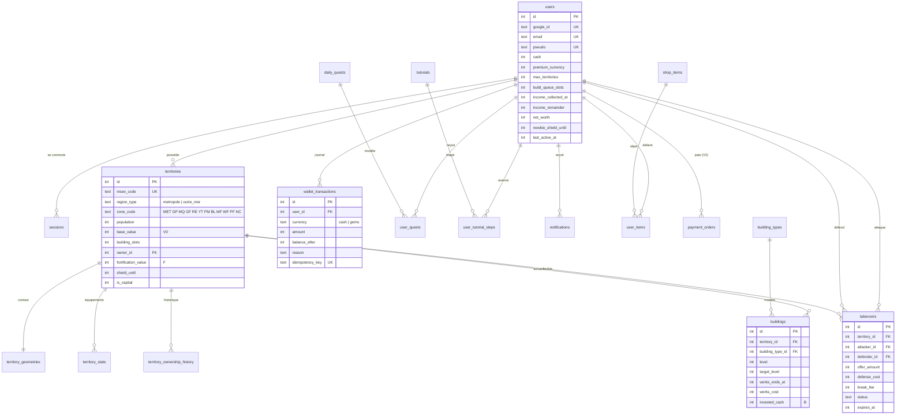

# 3. Base de données (SQLite)

Le schéma exact, exécutable, est dans le code :

- [`backend/src/db/migrations/001_initial.sql`](../backend/src/db/migrations/001_initial.sql) — 19 tables `STRICT`, index, déclencheurs
- [`backend/src/db/migrations/002_seed.sql`](../backend/src/db/migrations/002_seed.sql) — catalogues : bâtiments, tutoriel, quêtes, boutique
- [`backend/src/db/migrations/003_economie_etape3.sql`](../backend/src/db/migrations/003_economie_etape3.sql) — étape 3 : bâtiments à 5 niveaux et gare, prix du chantier (`works_cost`), 4 territoires au départ
- [`backend/src/db/migrations/004_reste_revenus.sql`](../backend/src/db/migrations/004_reste_revenus.sql) — étape 3 : reste des revenus (`income_remainder`), pour ne perdre aucune fraction de ₮
- [`backend/src/db/schema.test.mjs`](../backend/src/db/schema.test.mjs) — 30 tests (`node --test backend/`), lancés par la CI à chaque push

> Cette page explique le schéma. En cas de doute, **le fichier SQL fait foi**.

## 3.1 Conventions

| Règle | Détail |
|---|---|
| Tables `STRICT` | SQLite refuse un texte dans une colonne entière (testé) |
| Dates | `INTEGER`, secondes Unix UTC, `unixepoch()` par défaut. Le fuseau `Europe/Paris` ne sert qu'à l'affichage et au « jour » des quêtes |
| Argent | `INTEGER` uniquement. `cash` = monnaie de jeu, `premium_currency` = gemmes |
| Clés | `id INTEGER PRIMARY KEY` (alias du rowid) ; codes métier en `UNIQUE` (`insee_code`, `code`, `sku`) |
| Énumérations | `CHECK (col IN (...))` : la base refuse une valeur inconnue |
| Migrations | fichiers numérotés, **jamais modifiés** une fois fusionnés |

## 3.2 Schéma relationnel



## 3.3 Les tables, une par une

### Joueurs

**`users`** — un joueur = un compte Google.
- Identité : `google_id` (le `sub` du jeton), `email`, `pseudo` (unique, insensible à la casse, 3–24 caractères), `avatar_url`.
- Portefeuille : `cash ≥ 0`, `premium_currency ≥ 0` (la base refuse un solde négatif).
- Limites : `max_territories` (1–12), `extra_territory_slots` (0–1, boutique V2), `build_queue_slots` (1–3), `rank_level`. La création de compte écrit elle-même `max_territories = 4` et `build_queue_slots = 1` (`TERRITOIRES_DEPART`, `FILES_CONSTRUCTION_DEPART` de balance.ts) : la valeur par défaut de la colonne (3, migration 001) date d'avant l'étape 3 ; la migration 003 a donné +1 aux joueurs déjà inscrits.
- Économie : `income_collected_at` (point de départ du calcul des revenus hors ligne), `income_remainder` (0 à 3 599 : la fraction de ₮ pas encore versée, en ₮ × secondes, migration 004), `net_worth` (patrimoine en cache pour le classement).
- Protection : `newbie_shield_until` = inscription + 72 h.
- Index : `(status, last_active_at)` pour la tâche d'inactivité ; `net_worth DESC` (joueurs actifs) pour le classement.

**`sessions`** — `id` = SHA-256 du jeton du cookie (jamais le jeton lui-même), `expires_at`, `last_seen_at`.

### Territoires

**`territories`** — une ligne par commune française importée.
- Géographie : `insee_code` (5 caractères), `department_code`, `region_code`, **`region_type`** (`metropole` / `outre_mer`), **`zone_code`** (12 zones autorisées, la base refuse le reste), `population`, `area_km2`, centre.
- Valeurs calculées à l'import : `infra_score` (I), `base_value` (V0), `building_slots`, `balance_version`.
- Propriété : `owner_id` (NULL = libre), `acquired_at`, `acquired_price`, `fortification_value` (F, gagnée en défendant une OPA), `shield_until`, `is_capital` (héberge le siège social, immunisé contre les OPA ; une seule capitale par joueur grâce à un index unique partiel).

**`territory_geometries`** — contours GeoJSON `geojson_low` / `geojson_high`, séparés pour garder `territories` légère.

**`territories_rtree`** — table virtuelle R*Tree : boîte englobante de chaque commune. Requête type :

```sql
SELECT t.id, t.insee_code, t.name, t.owner_id, g.geojson_low
FROM territories_rtree r
JOIN territories t ON t.id = r.id
JOIN territory_geometries g ON g.territory_id = t.id
WHERE r.max_lng >= :west AND r.min_lng <= :east
  AND r.max_lat >= :south AND r.min_lat <= :north
LIMIT 3000;
```

**`territories_fts`** — recherche plein texte FTS5, insensible aux accents (« saint etienne » trouve « Saint-Étienne »), tenue à jour par 3 déclencheurs.

**`territory_stats`** — nombre d'équipements par commune, catégorie et source (`bpe` ou `osm`). Sert au calcul de I.

**`territory_ownership_history`** — chaque changement de propriétaire (achat, vente, OPA, inactivité, admin), avec le prix.

### Bâtiments

**`building_types`** — catalogue (7 types en V1 : résidence, commerce, usine, quartier d'affaires, équipement public, gare, siège social ; niveau 5 au maximum). Contient tous les paramètres d'équilibrage : coût, croissance du coût, revenu, bonus en %, temps de construction, niveau max, emplacements occupés, limites par territoire et par joueur, population minimale. Valeurs de 002, remplacées par 003 (docs/05, 5.2) ; servies telles quelles par `GET /building-types`.

**`buildings`** — un bâtiment posé sur un territoire.
- `level` = niveau **actif** (0 pendant la toute première construction).
- Chantier en cours : `target_level = level + 1`, `works_ends_at` et `works_cost` renseignés (la base impose les trois ensemble, et interdit de sauter un niveau).
- `works_cost` = prix payé pour le chantier en cours (> 0) : une annulation rend exactement ce montant, même si f_T a changé depuis (nouvel import).
- `invested_cash` = total dépensé (B), chantier en cours compris ; compte dans la valeur du territoire.
- Pas de colonne « propriétaire » : c'est celui du territoire (les bâtiments suivent le territoire lors d'une OPA).

### PvP

**`takeovers`** — une OPA.
- Montants **figés au lancement** : `territory_value`, `offer_amount` (bloqué chez l'attaquant), `defense_cost`, `break_fee`.
- `status` : `pending` → `defended` | `accepted` | `succeeded` | `cancelled` | `voided`. La base impose `resolved_at` dès que ce n'est plus `pending`.
- Index unique partiel : **une seule OPA en cours par commune**. Index sur `expires_at` (OPA en attente) pour la tâche de résolution, et sur `(attacker_id, defender_id, created_at)` pour le délai anti-acharnement.

### Portefeuille

**`wallet_transactions`** — le journal d'audit de **tous** les mouvements de cash et de gemmes.
- `amount` signé, `balance_after` (solde après l'opération : permet de vérifier le solde à tout moment), `reason` (liste fermée), `ref_type` / `ref_id` (l'objet concerné), `idempotency_key` unique, `metadata` JSON.
- **En ajout seul** : deux déclencheurs refusent `UPDATE` et `DELETE`. Une erreur se corrige par une nouvelle ligne (`admin_adjustment`).
- Règle applicative : **une seule fonction** modifie un solde, `wallet.apply(tx, { userId, currency, amount, reason, ref, idempotencyKey })`, qui met à jour `users` et écrit le journal dans la même transaction.

### Rétention

**`tutorials`** + **`user_tutorial_steps`** — 10 étapes ; chacune dit quel élément mettre en avant (`ui_anchor`), quel événement la valide (`completion_event`) et qui la valide (`server` pour les actions de jeu, `client` pour « j'ai zoomé »).

**`daily_quests`** (catalogue) + **`user_quests`** — 3 quêtes par joueur et par jour (`slot` 1 = facile, 2 = moyenne, 3 = difficile). La récompense est figée au tirage. Contraintes : une quête ne sort pas deux fois le même jour, pas de 4ᵉ quête, pas de réclamation avant d'avoir fini.

**`notifications`** — OPA reçue, OPA résolue, chantier fini, alerte d'inactivité. Index partiel sur les non lues. Chantier fini : `kind = 'building_done'`, `payload` au format `chantierFiniSchema` (shared/src/api/economie.ts), `created_at` = date de fin du chantier ; écrit par l'encaissement (`backend/src/modules/income/revenus.ts`).

### Monétisation V2 (créée, inactive)

- **`shop_items`** : skins de marqueurs, 2ᵉ file de construction, boost de revenus temporaire, emplacement de territoire. `is_active = 0` partout en V1. Les objets « de puissance » ont aussi un prix en cash.
- **`user_items`** : objets possédés, `expires_at` pour les boosts, `is_equipped` pour les skins.
- **`payment_orders`** : commandes Stripe (V2). Le webhook Stripe créditera les gemmes via `wallet.apply(..., reason: 'gems_purchase')`.

### Exploitation

**`job_runs`** — journal des tâches planifiées + verrou (une seule exécution `running` par tâche).

## 3.4 Ce que la base garantit, ce que le code garantit

| Garanti par SQLite (testé) | Garanti par le code (à tester aux étapes 3–4) |
|---|---|
| Solde jamais négatif | Limite de territoires (`max_territories`) |
| Commune hors des 12 zones refusée | Emplacements de bâtiments disponibles |
| Une seule OPA en cours par commune | Bouclier, protection débutant, délai de 7 jours entre deux OPA du même attaquant sur le même défenseur |
| Pas d'OPA sur soi-même | Capitale immunisée |
| Journal financier inaltérable, pas de double paiement | Tout mouvement d'argent passe par `wallet.apply` |
| Une capitale max par joueur | Un seul siège social par joueur |
| Chantier cohérent (pas de saut de niveau) | Une seule file de construction (2ᵉ et 3ᵉ achetables plus tard) |

## 3.5 Exploitation

- **Sauvegarde** : Litestream réplique le fichier WAL en continu vers un stockage S3 ; restauration testée à l'étape 6.
- **Migrations** : au démarrage, le serveur applique les fichiers `migrations/*.sql` pas encore joués (table `schema_migrations`, créée par le petit exécuteur de migrations de l'étape 1).
- **RGPD** : suppression = `status = 'deleted'`, e-mail remplacé par un hachage, pseudo par « Joueur supprimé #id », `google_id` par `deleted:<id>`, territoires libérés.
