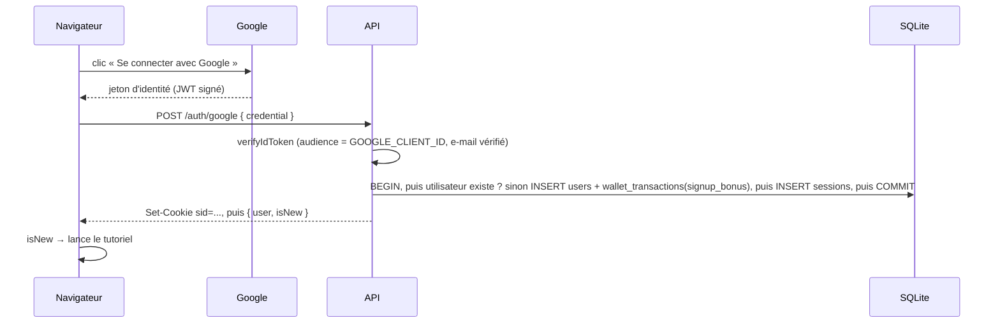
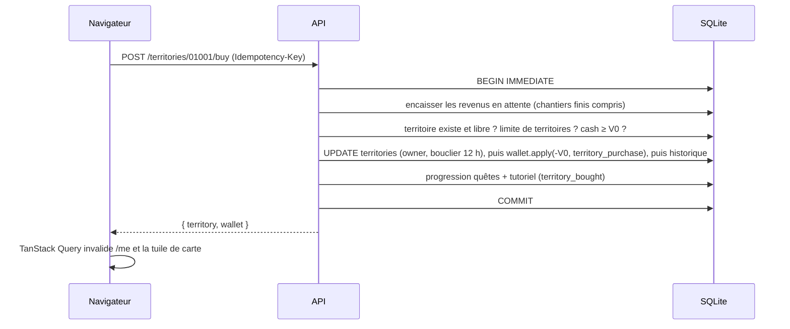
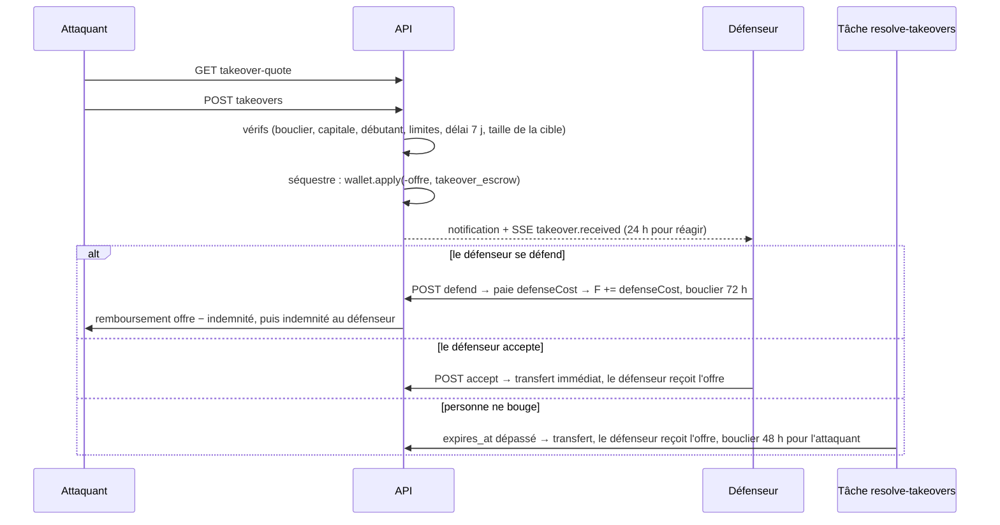

# 4. API REST et flux de données

## 4.1 Conventions

| Sujet | Règle |
|---|---|
| Préfixe | `/api/v1` |
| Format | JSON, champs en `camelCase` côté API (`snake_case` reste dans SQL) |
| Authentification | Cookie de session `sid` (HttpOnly). 🔒 = connexion obligatoire, 🛡️ = rôle admin |
| Validation | Schémas **zod** dans `shared/src/api/` : les mêmes servent au front et au back |
| Idempotence | Les actions qui coûtent de l'argent (💰) acceptent `Idempotency-Key: <uuid>` (8 à 100 caractères : lettres, chiffres, `-`, `_`) ; rejouer la même clé renvoie le même résultat sans repayer. La clé est rangée dans `wallet_transactions.idempotency_key`, préfixée par l'action et le joueur (`wallet/idempotence.ts`) ; une clé déjà servie pour une autre commune → 400 |
| Revenus | Toute requête 🔒 qui lit ou dépense le portefeuille **encaisse d'abord** les revenus en attente (calcul différé) et termine les chantiers finis : `GET`/`PATCH /me`, `GET /me/territories`, `GET /me/construction-queue`, `GET /me/notifications`, `GET /me/quests`, `POST /me/collect`, achat, vente, bâtiments, capitale, OPA. Avant de compter les revenus, les OPA dont les 24 h sont passées sont résolues (la commune change de main à `expires_at`, chacun touche les revenus pour son temps). Moteur : `backend/src/modules/income/revenus.ts` |
| Pagination | `?cursor=...&limit=50` → `{ items, nextCursor }` |
| Erreurs | `{ "error": { "code": "INSUFFICIENT_FUNDS", "message": "Il manque 1 200 ₮", "details": {...} } }` avec un statut HTTP cohérent |
| Monnaie affichée | `₮` (« tycoon ») pour le cash, 💎 pour les gemmes |

### Codes d'erreur métier

| Code | HTTP | Quand |
|---|---|---|
| `UNAUTHENTICATED` | 401 | Pas de session valide |
| `FORBIDDEN` | 403 | Pas le propriétaire, pas admin ; OPA sur une commune libre ou à soi |
| `TERRITORY_NOT_FOUND` | 404 | Code INSEE inconnu (= hors France ou TAAF) |
| `TERRITORY_NOT_FREE` | 409 | Achat d'une commune déjà possédée |
| `TERRITORY_LIMIT_REACHED` | 409 | `max_territories` atteint (OPA en cours comprises) |
| `INSUFFICIENT_FUNDS` | 409 | Pas assez de cash |
| `NO_FREE_SLOT` | 409 | Plus d'emplacement de bâtiment |
| `BUILD_QUEUE_FULL` | 409 | Toutes les files de construction occupées |
| `BUILDING_REQUIREMENT` | 409 | Population trop faible, limite par territoire/joueur, niveau max |
| `SHIELD_ACTIVE` | 409 | Territoire sous bouclier |
| `CAPITAL_IMMUNE` | 409 | OPA sur une capitale, ou vente de sa capitale |
| `NEWBIE_PROTECTION` | 409 | Cible (ou attaquant) protégé 72 h / compte de moins de 7 jours |
| `TAKEOVER_ALREADY_PENDING` | 409 | OPA déjà en cours sur cette commune |
| `TAKEOVER_LIMIT` | 409 | Trop d'OPA sortantes, ou défenseur déjà visé par 2 OPA |
| `TAKEOVER_COOLDOWN` | 409 | Même attaquant → même défenseur, moins de 7 jours après un échec |
| `TAKEOVER_NOT_PENDING` | 409 | Répondre à une OPA déjà terminée (défendue, acceptée, retirée, ou 24 h passées) ; `details.status` |
| `TARGET_TOO_SMALL` | 409 | Patrimoine de la cible < 25 % du vôtre (anti-acharnement) |
| `WORKS_IN_PROGRESS` | 409 | Démolir un bâtiment pendant son chantier (l'annuler d'abord) |
| `NO_WORKS_IN_PROGRESS` | 409 | Annuler un chantier alors qu'il n'y en a pas |
| `CAPITAL_COOLDOWN` | 409 | Déplacer sa capitale moins de 7 jours après le dernier déplacement |
| `PSEUDO_TAKEN` | 409 | Pseudo déjà pris par un autre joueur (majuscules ignorées) |
| `QUEST_NOT_CLAIMABLE` | 409 | Réclamer une quête pas encore finie ou déjà réclamée ; `details.reason` (`not_completed`, `already_claimed`) |
| `VALIDATION_ERROR` | 400 | Corps de requête invalide |
| `RATE_LIMITED` | 429 | Trop de requêtes |
| `FEATURE_DISABLED` | 404 | Boutique en V1, connexion Google pas configurée |

## 4.2 Points d'entrée

### Authentification et profil

| Méthode | Route | | Corps → Réponse |
|---|---|---|---|
| GET | `/auth/config` | | → `{ googleClientId, devLogin }` : ce que l'écran de connexion doit afficher (l'ID client Google n'est pas un secret) |
| POST | `/auth/google` | | `{ credential }` (jeton d'identité Google) → `{ user, isNew }` + cookie. Crée le compte au premier passage : 30 000 ₮ (`signup_bonus`), bouclier 72 h |
| POST | `/auth/dev` | | `{ pseudo }` → comme `/auth/google`, sans Google. **Local seulement** : la route n'existe que si `AUTH_DEV=true`, refusé avec `NODE_ENV=production` |
| POST | `/auth/logout` | 🔒 | → 204, session supprimée |
| GET | `/me` | 🔒 | → profil, portefeuille, revenu/h (sol + bâtiments), `maxTerritories`, territoires possédés/max, `rankLevel` (rang, 0 Entrepreneur … 4 Tycoon), file de construction, notifications non lues, `finishedWorks` : chantiers finis pas encore vus (résumé au retour, 50 au plus, avec `notificationId` pour les marquer lus) ; état du tutoriel plus tard |
| PATCH | `/me` | 🔒 | `{ pseudo?, markerColor? }` (pseudo 3 à 24 caractères, couleur `#rrggbb`) → même réponse que `GET /me` ; `PSEUDO_TAKEN` si le pseudo est pris |
| POST | `/me/collect` | 🔒 | → `{ collected, cash, incomePerHour }` (encaissement explicite, utile pour le tutoriel et les quêtes) ; `collected` vaut 0 si moins d'un ₮ s'est accumulé (la fraction est gardée). Fait avancer « Trésorier » si `collected > 0`, une fois par heure au plus |
| DELETE | `/me` | 🔒 | → 204, anonymisation RGPD |

### Carte

| Méthode | Route | | Corps → Réponse |
|---|---|---|---|
| GET | `/map/zones` | | → les 12 zones : code, nom, boîte, zoom conseillé (statique, mis en cache 1 jour) |
| GET | `/map/territories?bbox=W,S,E,N&zoom=Z` | | → GeoJSON `FeatureCollection` des communes visibles : `insee`, `name`, `state` (`free`, `mine`, `rival`, `takeover`, `shield`), `ownerColor`, `ownerPseudo`. Contour `low` (zoom 9–10) ou `high` (≥ 11). Zoom < 9 → 400. Max 3 000 communes. En-tête `ETag` |
| GET | `/map/search?q=...` | | → 10 communes max (FTS5) : `insee`, `name`, `department`, `zone`, centre |
| GET | `/territories/:insee` | | → fiche : population, équipements par catégorie, V0, valeur totale, revenu/h, emplacements, propriétaire, bâtiments, bouclier, OPA en cours, et les **actions possibles** pour le joueur connecté (`canBuy`, `buyPrice`, `buyReasons[]`, `canSell`, `sellPrice`, `sellReasons[]`, `canTakeover`, `takeoverReasons[]`). Les raisons sont des codes d'erreur : achat `UNAUTHENTICATED` (pas connecté), `TERRITORY_NOT_FREE`, `TERRITORY_LIMIT_REACHED`, `INSUFFICIENT_FUNDS` ; vente `UNAUTHENTICATED`, `FORBIDDEN` (pas à moi), `CAPITAL_IMMUNE`, `TAKEOVER_ALREADY_PENDING` (`sellPrice` seulement sur ma commune) ; OPA : `UNAUTHENTICATED`, puis les raisons du devis ci-dessous. Mêmes règles que les routes d'achat, de vente (`territories/achat-vente.ts`) et d'OPA (`takeovers/conditions.ts`). Code en minuscules accepté (`2a004`) |

### Économie : territoires et bâtiments

| Méthode | Route | | Corps → Réponse |
|---|---|---|---|
| GET | `/me/territories` | 🔒 | → `{ territories, max }` : mes communes (capitale d'abord, puis dans l'ordre d'achat) avec V0, valeur totale, revenu/h, bouclier, emplacements et chantiers en cours (prix payé compris) |
| POST | `/territories/:insee/buy` | 🔒💰 | → `{ territory, wallet }` : la fiche à jour + portefeuille. Prix = V0. Bouclier 12 h. Erreurs : `TERRITORY_NOT_FOUND`, `TERRITORY_NOT_FREE`, `TERRITORY_LIMIT_REACHED` (OPA sortantes comprises), `INSUFFICIENT_FUNDS` (avec `details.missing`) |
| POST | `/territories/:insee/sell` | 🔒💰 | → `{ insee, saleAmount, wallet }` : 70 % de la valeur totale, arrondi à la centaine inférieure (vente à l'État). Les bâtiments sont **détruits** (chantier compris), la commune redevient libre au prix V0. Erreurs : `FORBIDDEN` (pas à moi), `CAPITAL_IMMUNE`, `TAKEOVER_ALREADY_PENDING` |
| GET | `/building-types` | | → `{ buildingTypes }` : les types actifs (`typeBatimentSchema`), siège social en dernier. Public, cache 1 h. Une entrée se passe telle quelle à `coutNiveau`, `revenuNiveau`, `dureeChantier` (balance.ts) pour les aperçus |
| POST | `/territories/:insee/buildings` | 🔒💰 | `{ typeCode }` → `{ building, wallet }` : bâtiment en chantier (niveau 0 → 1). Le tout premier chantier du joueur dure 10 s (tutoriel). Un siège social fait de la commune la capitale dès le début du chantier. Erreurs : `TERRITORY_NOT_FOUND`, `FORBIDDEN` (pas à moi), `NOT_FOUND` (type inconnu), `BUILD_QUEUE_FULL` (`details.slots`), `NO_FREE_SLOT` (`details.needed`, `details.free`), `BUILDING_REQUIREMENT` (population, une par commune, un par joueur), `INSUFFICIENT_FUNDS` |
| POST | `/buildings/:id/upgrade` | 🔒💰 | → `{ building, wallet }` : chantier niveau L → L+1 ; le bâtiment rapporte au niveau L pendant les travaux. Erreurs : `NOT_FOUND`, `FORBIDDEN`, `WORKS_IN_PROGRESS`, `BUILDING_REQUIREMENT` (niveau max), `BUILD_QUEUE_FULL`, `INSUFFICIENT_FUNDS` |
| POST | `/buildings/:id/cancel` | 🔒💰 | → `{ building, refunded, wallet }` : annule le chantier en cours, **rembourse tout son coût** ; le bâtiment reste à son niveau. Une 1re construction annulée supprime le bâtiment (`building: null`) et, pour un siège, la capitale. Erreurs : `NOT_FOUND`, `FORBIDDEN`, `NO_WORKS_IN_PROGRESS` |
| DELETE | `/buildings/:id` | 🔒 | → `{ refunded, wallet }` : démolition, rembourse 30 % de `invested_cash`. Erreurs : `NOT_FOUND`, `FORBIDDEN`, `CAPITAL_IMMUNE` (le siège social ne se démolit pas), `WORKS_IN_PROGRESS` (annuler le chantier d'abord) |
| GET | `/me/construction-queue` | 🔒 | → `{ slots, works }` : nombre de files et chantiers en cours (commune, type, niveau visé, début, fin, prix payé), le plus proche de la fin d'abord |
| POST | `/me/capital` | 🔒 | `{ insee }` → `{ capitalInsee, nextMoveAt }` : le siège social (niveau compris) part sur une autre de mes communes ; une fois tous les 7 jours (construire le siège ne compte pas). Erreurs : `TERRITORY_NOT_FOUND`, `FORBIDDEN`, `BUILDING_REQUIREMENT` (pas de siège), `VALIDATION_ERROR` (déjà la capitale), `CAPITAL_COOLDOWN` (`details.nextMoveAt`), `WORKS_IN_PROGRESS` (siège en chantier), `NO_FREE_SLOT`, `TAKEOVER_ALREADY_PENDING` |

### PvP : OPA

| Méthode | Route | | Corps → Réponse |
|---|---|---|---|
| GET | `/territories/:insee/takeover-quote` | 🔒 | → `{ territoryValue, offerAmount, defenseCost, breakFee, eligible, reasons[] }` : les montants qui seraient figés maintenant (docs/05, 5.5 ; encaisse d'abord). Raisons, dans l'ordre : `FORBIDDEN` (commune libre ou à soi, seule raison dans ce cas), `CAPITAL_IMMUNE`, `SHIELD_ACTIVE`, `NEWBIE_PROTECTION` (défenseur protégé 72 h, ou compte de l'attaquant de moins de 7 jours), `TAKEOVER_ALREADY_PENDING`, `TAKEOVER_LIMIT`, `TAKEOVER_COOLDOWN`, `TARGET_TOO_SMALL`, `TERRITORY_LIMIT_REACHED`, `INSUFFICIENT_FUNDS` ; sans doublon. `TERRITORY_NOT_FOUND` si le code est inconnu |
| POST | `/territories/:insee/takeovers` | 🔒💰 | → `{ takeover, wallet }` : OPA `pending`, 24 h pour répondre ; `offerAmount` bloqué (débité en `takeover_escrow`) ; notification `takeover_received` au défenseur (et en direct sur `/events`) ; l'attaquant perd sa protection débutant. Refus : la première raison du devis (403/409), `INSUFFICIENT_FUNDS` avec `details.missing`. Moteur : `backend/src/modules/takeovers/lancement.ts` |
| GET | `/me/takeovers?role=attacker\|defender&status=pending` | 🔒 | → `{ takeovers }` : mes OPA (100 au plus), les plus récentes d'abord ; `role` et `status` facultatifs. Résout d'abord les OPA échues |
| GET | `/takeovers/:id` | 🔒 | → `{ takeover }` (attaquant ou défenseur seulement, sinon `NOT_FOUND`). Résout l'OPA si ses 24 h sont passées |
| POST | `/takeovers/:id/defend` | 🔒💰 | Défenseur : paie `defenseCost` (`takeover_defense`) et reçoit `breakFee` ; l'attaquant récupère `offerAmount − breakFee` (`takeover_refund`). → `defended`, `F += defenseCost`, bouclier 72 h. → `{ takeover, wallet }` |
| POST | `/takeovers/:id/accept` | 🔒 | Défenseur : vend tout de suite → `accepted` ; il reçoit `offerAmount` (`takeover_payout`), la commune passe à l'attaquant avec ses bâtiments et chantiers, bouclier 48 h. Même chose sans réponse au bout de 24 h → `succeeded` |
| POST | `/takeovers/:id/cancel` | 🔒💰 | Attaquant : retire l'offre → `cancelled` ; il récupère `offerAmount − breakFee`, l'indemnité est versée au défenseur |

Réponses : `FORBIDDEN` si ce n'est pas son rôle (le défenseur défend ou accepte, l'attaquant retire), `TAKEOVER_NOT_PENDING` si l'OPA est terminée, `INSUFFICIENT_FUNDS` pour une défense trop chère. Chaque issue envoie une notification `takeover_resolved` à l'autre joueur (aux deux pour `succeeded`). Les OPA échues sont résolues par la tâche `resolve-takeovers` (chaque minute) et dès qu'on lit : encaissement, fiche de la commune, `/takeovers/:id`, `/me/takeovers`. Moteur : `backend/src/modules/takeovers/issues.ts` et `reponses.ts`

### Quêtes, tutoriel, classement

| Méthode | Route | | Corps → Réponse |
|---|---|---|---|
| GET | `/me/quests` | 🔒 | → `{ date, resetsAt, quests[] }` : les 3 quêtes du jour (1 facile, 1 moyenne, 1 difficile), tirées au premier appel de la journée (heure de Paris, `date` = `AAAA-MM-JJ`) ; `resetsAt` = prochain minuit à Paris. Chaque quête : `{ id, slot, code, title, description, difficulty, eventType, target, progress, rewardCash, rewardGems, completedAt, claimedAt }`. Encaisse d'abord (un chantier fini fait avancer ses quêtes). Une quête réussie envoie le message `quest_completed`. Code : `backend/src/modules/quests/` |
| POST | `/me/quests/:id/claim` | 🔒💰 | → `{ quest, wallet }` : récompense versée (`quest_reward`). Erreurs : `NOT_FOUND` (pas à moi), `QUEST_NOT_CLAIMABLE` (pas finie ou déjà réclamée). Une quête d'un jour passé se réclame encore. `Idempotency-Key` accepté |
| GET | `/tutorial` | 🔒 | → `{ steps[], completedAt, skipped }` ; chaque étape : `{ key, position, title, body, anchor, validatedBy, rewardCash, rewardGems, completedAt }`. Encaisse d'abord (le premier chantier fini valide « Construis »). Étapes validées par le serveur : achat (5), premier chantier **fini** (6), clic sur « Encaisser » même s'il rapporte 0 (7), classement vu (10, par `/events/track`), dans n'importe quel ordre. Code : `backend/src/modules/tutorial/` |
| POST | `/tutorial/:stepKey/complete` | 🔒 | → même réponse + `wallet`. Seulement pour les étapes `validatedBy = 'client'` (`FORBIDDEN` sinon, `NOT_FOUND` si la clé est inconnue) ; les autres sont validées par le serveur quand l'action a lieu. Rejouer une étape faite ne fait rien ; après « Passer » ou une fois fini, rien ne change |
| POST | `/tutorial/skip` | 🔒 | → même réponse que `GET /tutorial` : passe le tutoriel (pas de récompense pour les étapes non faites ; plus aucune étape ne compte ensuite) |
| POST | `/events/track` | 🔒 | `{ type: 'territory_visited' \| 'zone_visited' \| 'leaderboard_viewed', ref }` → 204 : fait avancer quêtes et tutoriel (60 par minute et par joueur, sinon `RATE_LIMITED`). Une même commune ou zone ne compte qu'une fois par jour. `territory_visited` : code INSEE existant (`NOT_FOUND` sinon) ; `zone_visited` : code de zone (`VALIDATION_ERROR` sinon), `MET` accepté mais ne compte pas. Code : `backend/src/modules/evenements/suivi.ts` |
| GET | `/leaderboard?scope=national\|metropole\|outre_mer\|region:84&cursor=` | | → `{ scope, players[], nextCursor, me, updatedAt }` ; chaque ligne : `{ rank, pseudo, avatar, markerColor, netWorth, territories, rankLevel }`, 50 par page ; `me` = ma ligne si je suis connecté et dans la portée ; `updatedAt` = dernier passage de la tâche `leaderboard`. Hors national : les joueurs qui possèdent au moins une commune dans la portée, classés par patrimoine total. Seuls les comptes actifs sont classés (ni bannis ni endormis) ; à patrimoine égal, le compte le plus ancien passe devant. Simple lecture : « classement vu » passe par `/events/track`. Code : `backend/src/modules/leaderboard/` |
| GET | `/players/:pseudo` | | → `{ pseudo, avatar, markerColor, rankLevel, netWorth, nationalRank, createdAt, territories[] }` : profil public (ni cash, ni gemmes). `NOT_FOUND` si le pseudo est inconnu ou le compte banni (un compte endormi reste visible). Pseudo sans tenir compte des majuscules ; communes : la capitale d'abord |

Contrat : `shared/src/api/quetes.ts`, `tutoriel.ts`, `classement.ts` ; règles dans [05-equilibrage.md](05-equilibrage.md#57-quêtes-et-tutoriel) (5.4 et 5.7).

### Notifications et temps réel

| Méthode | Route | | Corps → Réponse |
|---|---|---|---|
| GET | `/me/notifications?before=<id>&limit=20` | 🔒 | → `{ notifications, nextCursor, unreadNotifications }`, les plus récents d'abord (50 au plus par page). Types (`kind`) : `building_done`, `takeover_received`, `takeover_resolved`, `inactivity_warning`, `inactivity_released`, `quest_completed`, `rank_up` ; contenu de chacun dans `shared/src/api/notifications.ts`. `nextCursor` = `before` de la page suivante. Encaisse d'abord (les chantiers finis ont leur message) ; un type inconnu du contrat n'est pas listé. Code : `backend/src/modules/notifications/liste.ts` |
| POST | `/me/notifications/read` | 🔒 | `{ ids[] }` (1 à 100) ou `{ all: true }` → `{ unreadNotifications }` ; seulement ses propres messages |
| GET | `/events` | 🔒 | Flux SSE (`event: <type>` puis `data: <JSON>`) : `takeover.received`, `takeover.resolved`, `building.done` (le message du centre de notifications), `wallet.changed` (`{ cash, gems, incomePerHour }`, après une issue d'OPA ou un rachat pour inactivité), `quest.completed` (le message `quest_completed` : `{ questId, code, title, rewardCash, rewardGems }`), `rank.up` (le message `rank_up` : `{ rankLevel, previousLevel, maxTerritories }`, écrit par la tâche `leaderboard`). Pas d'événement pour l'avertissement d'inactivité. Voir ci-dessous |

Le flux relit la table `notifications` : tant qu'un joueur écoute, un passage chaque seconde termine ce qui est dû pour ceux qui regardent (OPA échues, chantiers finis : à la seconde près, sans attendre une action), puis envoie les messages écrits depuis le passage d'avant, quelle que soit la route ou la tâche qui les a écrits. Rien d'une transaction annulée n'est envoyé. Un commentaire `: ping` toutes les 25 s garde la connexion ouverte ; `retry: 5000` : le navigateur se reconnecte seul au bout de 5 s. 5 onglets par joueur au plus (le plus ancien est fermé). Pas de rattrapage à la reconnexion : le front relit `/me` et `/me/notifications` à chaque ouverture du flux. Un seul serveur pour l'instant (les abonnés sont en mémoire). Code : `backend/src/modules/notifications/direct.ts` et `routes.ts`

### Boutique (V2, renvoie `FEATURE_DISABLED` tant que `FEATURE_SHOP=false`)

| Méthode | Route | | |
|---|---|---|---|
| GET | `/shop/items` | | catalogue actif |
| POST | `/shop/purchase` | 🔒💰 | `{ sku, currency: 'gems' \| 'cash' }` |
| POST | `/payments/checkout` | 🔒 | crée une session Stripe |
| POST | `/payments/stripe/webhook` | | signé par Stripe ; crédite les gemmes |

### Administration

| Méthode | Route | | |
|---|---|---|---|
| GET | `/admin/health` | | état du serveur, de la base, dernière exécution des tâches (sans 🛡️ pour la supervision, sans données sensibles) |
| POST | `/admin/jobs/:name/run` | 🛡️ | lance une tâche à la main |
| POST | `/admin/wallet-adjustments` | 🛡️ | correction tracée (`admin_adjustment`) |

## 4.3 Flux principaux

### Connexion Google

### Achat d'une commune

### OPA

## 4.4 Côté front : qui appelle quoi

| Écran | Appels |
|---|---|
| Carte | `/map/zones` (une fois), `/map/territories` à chaque fin de déplacement (anti-rebond 300 ms, cache par tuile de bbox arrondie) |
| Barre du haut (HUD) | `/me` toutes les 60 s ; entre deux appels, le cash affiché **monte en continu** côté client (revenu/h ÷ 3600 chaque seconde, plafond 48 h, `useCashEnDirect`), le serveur reste la référence. Chantier en cours : `/me/construction-queue`, relue juste après la fin du prochain chantier (le serveur le termine à la lecture), minuteur à la seconde ; un clic ouvre l'onglet « Bâtiments » de la commune (`frontend/src/hud/ChantierEnCours.tsx`) |
| Fiche commune | `/territories/:insee`, puis actions `buy`, `sell`, `takeover-quote`. Acheter et vendre passent par une confirmation avec aperçu (formules de `shared/`) ; une clé `Idempotency-Key` par confirmation (`frontend/src/panels/ActionsFiche.tsx`). Après un refus, la fiche et `/me` sont relus. Onglet « Bâtiments » (communes à soi) : `/building-types` (catalogue, 1 h), construire `POST …/buildings`, améliorer `…/upgrade`, arrêter `…/cancel`, démolir `DELETE /buildings/:id`, chacun avec confirmation et aperçu (prix, durée, revenu avant → après) ; `Idempotency-Key` sauf pour démolir (`frontend/src/panels/OngletBatiments.tsx`) |
| Résumé au retour | `finishedWorks` de `/me` : chantiers finis pas encore vus (« Pendant ton absence » s'ils ont fini avant l'ouverture de la page) ; « Compris » → `POST /me/notifications/read` (`frontend/src/hud/ResumeRetour.tsx`) |
| Mes territoires | `/me/territories` à l'ouverture de la liste (barre du haut) ; un clic ouvre la fiche et amène la carte sur la commune |
| OPA (fiche commune) | Commune d'un rival : bouton « Lancer une OPA » (aperçu `montantsOpa`), puis `takeover-quote` à l'ouverture de la confirmation (montants figés par le serveur) et `POST …/takeovers` ; sinon, la raison en clair (`opa-texte.ts`). OPA en cours : compte à rebours et `GET /takeovers/:id` ; défenseur : « Défendre » (`defend`, bloqué si le cash manque) ou « Accepter » (`accept`) ; attaquant : « Retirer mon offre » (`cancel`). Chaque réponse passe par une confirmation, avec `Idempotency-Key` sauf pour accepter. Après coup, `/me`, la fiche et la carte sont relus (`frontend/src/panels/ActionsOpa.tsx`) |
| Mes OPA | `/me/takeovers?status=pending` toutes les 60 s, sous la barre du haut : OPA reçues d'abord (orange), puis lancées, avec le temps restant ; un clic ouvre la fiche (`frontend/src/hud/MesOpa.tsx`). Légende des couleurs de la carte (rival, OPA en cours, bouclier) en bas à gauche (`frontend/src/hud/Legende.tsx`) |
| Notifications | Flux SSE `/events` ouvert tant que le joueur est connecté (`frontend/src/api/direct.ts`) : `wallet.changed` pose le solde, les autres relisent `/me` (mes OPA, centre de notifications compris), la fiche de la commune et la carte. Petits messages (toasts) : OPA reçue (« Réagir »), OPA terminée par l'autre joueur ou sans réponse ; rien pour ses propres actions ni pour un chantier fini (le résumé s'en charge). À chaque reconnexion, `/me`, les fiches et la carte sont relus ; après une réponse d'erreur (502, 401), le front rouvre le flux au bout de 10 s. Centre de notifications : volet « Messages » de la barre du haut, pastille = `unreadNotifications`, `/me/notifications` page par page ; un clic marque le message lu et ouvre la commune, « Tout marquer comme lu » → `{ all: true }` (`frontend/src/hud/CentreMessages.tsx`) |
| Erreurs | Une action refusée s'affiche à côté de son bouton. Une relecture en arrière-plan qui échoue (l'écran garde l'ancienne valeur) ou un échec du centre de notifications s'affiche en petit message rouge (`QueryCache` dans `frontend/src/main.tsx`, `frontend/src/hud/Toasts.tsx`) |
| Tutoriel | `/tutorial` au démarrage ; driver.js met en avant `[data-tuto="<ui_anchor>"]` |
