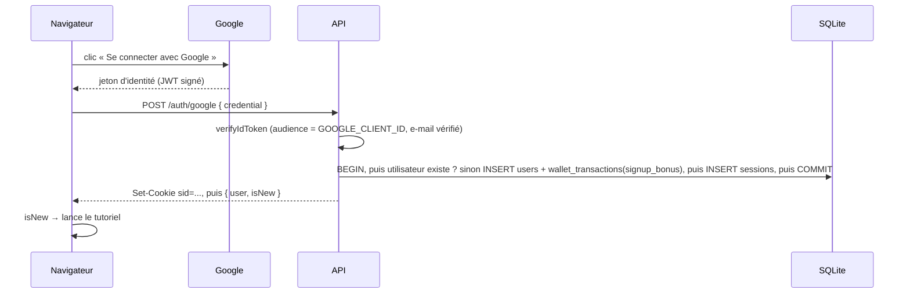
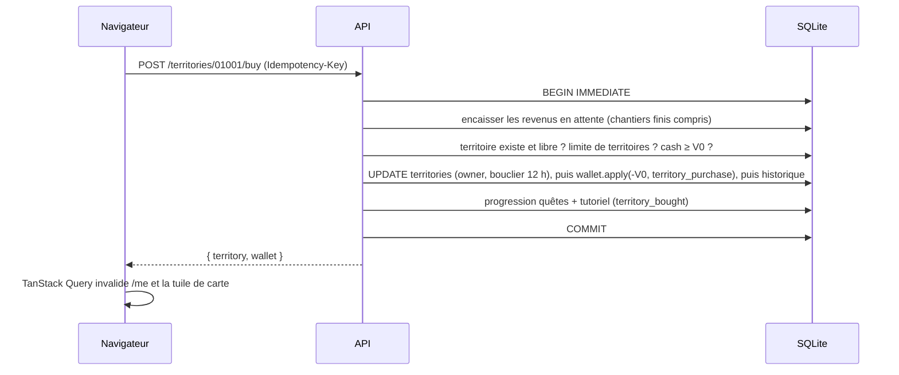
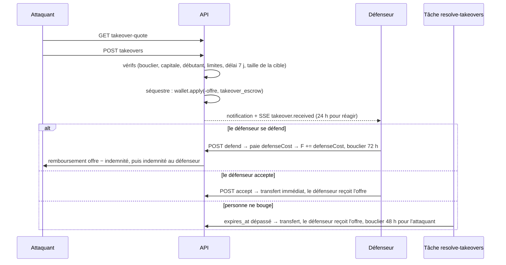

# 4. API REST et flux de données

## 4.1 Conventions

| Sujet | Règle |
|---|---|
| Préfixe | `/api/v1` |
| Format | JSON, champs en `camelCase` côté API (`snake_case` reste dans SQL) |
| Authentification | Cookie de session `sid` (HttpOnly). 🔒 = connexion obligatoire, 🛡️ = rôle admin |
| Validation | Schémas **zod** dans `shared/src/api/` : les mêmes servent au front et au back |
| Idempotence | Les actions qui coûtent de l'argent (💰) acceptent `Idempotency-Key: <uuid>` (8 à 100 caractères : lettres, chiffres, `-`, `_`) ; rejouer la même clé renvoie le même résultat sans repayer. La clé est rangée dans `wallet_transactions.idempotency_key`, préfixée par l'action et le joueur (`wallet/idempotence.ts`) ; une clé déjà servie pour une autre commune → 400 |
| Revenus | Toute requête 🔒 qui lit ou dépense le portefeuille **encaisse d'abord** les revenus en attente (calcul différé) et termine les chantiers finis : `GET`/`PATCH /me`, `GET /me/territories`, `GET /me/construction-queue`, `POST /me/collect`, achat, vente, bâtiments, capitale (puis OPA…). Moteur : `backend/src/modules/income/revenus.ts` |
| Pagination | `?cursor=...&limit=50` → `{ items, nextCursor }` |
| Erreurs | `{ "error": { "code": "INSUFFICIENT_FUNDS", "message": "Il manque 1 200 ₮", "details": {...} } }` avec un statut HTTP cohérent |
| Monnaie affichée | `₮` (« tycoon ») pour le cash, 💎 pour les gemmes |

### Codes d'erreur métier

| Code | HTTP | Quand |
|---|---|---|
| `UNAUTHENTICATED` | 401 | Pas de session valide |
| `FORBIDDEN` | 403 | Pas le propriétaire, pas admin |
| `TERRITORY_NOT_FOUND` | 404 | Code INSEE inconnu (= hors France ou TAAF) |
| `TERRITORY_NOT_FREE` | 409 | Achat d'une commune déjà possédée |
| `TERRITORY_LIMIT_REACHED` | 409 | `max_territories` atteint (OPA en cours comprises) |
| `INSUFFICIENT_FUNDS` | 409 | Pas assez de cash |
| `NO_FREE_SLOT` | 409 | Plus d'emplacement de bâtiment |
| `BUILD_QUEUE_FULL` | 409 | Toutes les files de construction occupées |
| `BUILDING_REQUIREMENT` | 409 | Population trop faible, limite par territoire/joueur, niveau max |
| `SHIELD_ACTIVE` | 409 | Territoire sous bouclier |
| `CAPITAL_IMMUNE` | 409 | OPA sur une capitale, ou vente de sa capitale |
| `NEWBIE_PROTECTION` | 409 | Cible (ou attaquant) protégé 72 h / compte de moins de 7 jours |
| `TAKEOVER_ALREADY_PENDING` | 409 | OPA déjà en cours sur cette commune |
| `TAKEOVER_LIMIT` | 409 | Trop d'OPA sortantes, ou défenseur déjà visé par 2 OPA |
| `TAKEOVER_COOLDOWN` | 409 | Même attaquant → même défenseur, moins de 7 jours après un échec |
| `TARGET_TOO_SMALL` | 409 | Patrimoine de la cible < 25 % du vôtre (anti-acharnement) |
| `WORKS_IN_PROGRESS` | 409 | Démolir un bâtiment pendant son chantier (l'annuler d'abord) |
| `NO_WORKS_IN_PROGRESS` | 409 | Annuler un chantier alors qu'il n'y en a pas |
| `CAPITAL_COOLDOWN` | 409 | Déplacer sa capitale moins de 7 jours après le dernier déplacement |
| `PSEUDO_TAKEN` | 409 | Pseudo déjà pris par un autre joueur (majuscules ignorées) |
| `VALIDATION_ERROR` | 400 | Corps de requête invalide |
| `RATE_LIMITED` | 429 | Trop de requêtes |
| `FEATURE_DISABLED` | 404 | Boutique en V1, connexion Google pas configurée, OPA avant l'étape 4 |

## 4.2 Points d'entrée

### Authentification et profil

| Méthode | Route | | Corps → Réponse |
|---|---|---|---|
| GET | `/auth/config` | | → `{ googleClientId, devLogin }` : ce que l'écran de connexion doit afficher (l'ID client Google n'est pas un secret) |
| POST | `/auth/google` | | `{ credential }` (jeton d'identité Google) → `{ user, isNew }` + cookie. Crée le compte au premier passage : 30 000 ₮ (`signup_bonus`), bouclier 72 h |
| POST | `/auth/dev` | | `{ pseudo }` → comme `/auth/google`, sans Google. **Local seulement** : la route n'existe que si `AUTH_DEV=true`, refusé avec `NODE_ENV=production` |
| POST | `/auth/logout` | 🔒 | → 204, session supprimée |
| GET | `/me` | 🔒 | → profil, portefeuille, revenu/h (sol + bâtiments), `maxTerritories`, territoires possédés/max, file de construction, notifications non lues, `finishedWorks` : chantiers finis pas encore vus (résumé au retour, 50 au plus, avec `notificationId` pour les marquer lus) ; état du tutoriel plus tard |
| PATCH | `/me` | 🔒 | `{ pseudo?, markerColor? }` (pseudo 3 à 24 caractères, couleur `#rrggbb`) → même réponse que `GET /me` ; `PSEUDO_TAKEN` si le pseudo est pris |
| POST | `/me/collect` | 🔒 | → `{ collected, cash, incomePerHour }` (encaissement explicite, utile pour le tutoriel et les quêtes) ; `collected` vaut 0 si moins d'un ₮ s'est accumulé (la fraction est gardée) |
| DELETE | `/me` | 🔒 | → 204, anonymisation RGPD |

### Carte

| Méthode | Route | | Corps → Réponse |
|---|---|---|---|
| GET | `/map/zones` | | → les 12 zones : code, nom, boîte, zoom conseillé (statique, mis en cache 1 jour) |
| GET | `/map/territories?bbox=W,S,E,N&zoom=Z` | | → GeoJSON `FeatureCollection` des communes visibles : `insee`, `name`, `state` (`free`, `mine`, `rival`, `takeover`, `shield`), `ownerColor`, `ownerPseudo`. Contour `low` (zoom 9–10) ou `high` (≥ 11). Zoom < 9 → 400. Max 3 000 communes. En-tête `ETag` |
| GET | `/map/search?q=...` | | → 10 communes max (FTS5) : `insee`, `name`, `department`, `zone`, centre |
| GET | `/territories/:insee` | | → fiche : population, équipements par catégorie, V0, valeur totale, revenu/h, emplacements, propriétaire, bâtiments, bouclier, OPA en cours, et les **actions possibles** pour le joueur connecté (`canBuy`, `buyPrice`, `buyReasons[]`, `canSell`, `sellPrice`, `sellReasons[]`, `canTakeover`, `takeoverReasons[]`). Les raisons sont des codes d'erreur : achat `UNAUTHENTICATED` (pas connecté), `TERRITORY_NOT_FREE`, `TERRITORY_LIMIT_REACHED`, `INSUFFICIENT_FUNDS` ; vente `UNAUTHENTICATED`, `FORBIDDEN` (pas à moi), `CAPITAL_IMMUNE`, `TAKEOVER_ALREADY_PENDING` (`sellPrice` seulement sur ma commune) ; OPA : `FEATURE_DISABLED` jusqu'à l'étape 4. Mêmes règles que les routes d'achat et de vente (`territories/achat-vente.ts`). Code en minuscules accepté (`2a004`) |

### Économie : territoires et bâtiments

| Méthode | Route | | Corps → Réponse |
|---|---|---|---|
| GET | `/me/territories` | 🔒 | → `{ territories, max }` : mes communes (capitale d'abord, puis dans l'ordre d'achat) avec V0, valeur totale, revenu/h, bouclier, emplacements et chantiers en cours (prix payé compris) |
| POST | `/territories/:insee/buy` | 🔒💰 | → `{ territory, wallet }` : la fiche à jour + portefeuille. Prix = V0. Bouclier 12 h. Erreurs : `TERRITORY_NOT_FOUND`, `TERRITORY_NOT_FREE`, `TERRITORY_LIMIT_REACHED` (OPA sortantes comprises), `INSUFFICIENT_FUNDS` (avec `details.missing`) |
| POST | `/territories/:insee/sell` | 🔒💰 | → `{ insee, saleAmount, wallet }` : 70 % de la valeur totale, arrondi à la centaine inférieure (vente à l'État). Les bâtiments sont **détruits** (chantier compris), la commune redevient libre au prix V0. Erreurs : `FORBIDDEN` (pas à moi), `CAPITAL_IMMUNE`, `TAKEOVER_ALREADY_PENDING` |
| GET | `/building-types` | | → `{ buildingTypes }` : les types actifs (`typeBatimentSchema`), siège social en dernier. Public, cache 1 h. Une entrée se passe telle quelle à `coutNiveau`, `revenuNiveau`, `dureeChantier` (balance.ts) pour les aperçus |
| POST | `/territories/:insee/buildings` | 🔒💰 | `{ typeCode }` → `{ building, wallet }` : bâtiment en chantier (niveau 0 → 1). Le tout premier chantier du joueur dure 10 s (tutoriel). Un siège social fait de la commune la capitale dès le début du chantier. Erreurs : `TERRITORY_NOT_FOUND`, `FORBIDDEN` (pas à moi), `NOT_FOUND` (type inconnu), `BUILD_QUEUE_FULL` (`details.slots`), `NO_FREE_SLOT` (`details.needed`, `details.free`), `BUILDING_REQUIREMENT` (population, une par commune, un par joueur), `INSUFFICIENT_FUNDS` |
| POST | `/buildings/:id/upgrade` | 🔒💰 | → `{ building, wallet }` : chantier niveau L → L+1 ; le bâtiment rapporte au niveau L pendant les travaux. Erreurs : `NOT_FOUND`, `FORBIDDEN`, `WORKS_IN_PROGRESS`, `BUILDING_REQUIREMENT` (niveau max), `BUILD_QUEUE_FULL`, `INSUFFICIENT_FUNDS` |
| POST | `/buildings/:id/cancel` | 🔒💰 | → `{ building, refunded, wallet }` : annule le chantier en cours, **rembourse tout son coût** ; le bâtiment reste à son niveau. Une 1re construction annulée supprime le bâtiment (`building: null`) et, pour un siège, la capitale. Erreurs : `NOT_FOUND`, `FORBIDDEN`, `NO_WORKS_IN_PROGRESS` |
| DELETE | `/buildings/:id` | 🔒 | → `{ refunded, wallet }` : démolition, rembourse 30 % de `invested_cash`. Erreurs : `NOT_FOUND`, `FORBIDDEN`, `CAPITAL_IMMUNE` (le siège social ne se démolit pas), `WORKS_IN_PROGRESS` (annuler le chantier d'abord) |
| GET | `/me/construction-queue` | 🔒 | → `{ slots, works }` : nombre de files et chantiers en cours (commune, type, niveau visé, début, fin, prix payé), le plus proche de la fin d'abord |
| POST | `/me/capital` | 🔒 | `{ insee }` → `{ capitalInsee, nextMoveAt }` : le siège social (niveau compris) part sur une autre de mes communes ; une fois tous les 7 jours (construire le siège ne compte pas). Erreurs : `TERRITORY_NOT_FOUND`, `FORBIDDEN`, `BUILDING_REQUIREMENT` (pas de siège), `VALIDATION_ERROR` (déjà la capitale), `CAPITAL_COOLDOWN` (`details.nextMoveAt`), `WORKS_IN_PROGRESS` (siège en chantier), `NO_FREE_SLOT`, `TAKEOVER_ALREADY_PENDING` |

### PvP : OPA

| Méthode | Route | | Corps → Réponse |
|---|---|---|---|
| GET | `/territories/:insee/takeover-quote` | 🔒 | → `{ territoryValue, offerAmount, defenseCost, breakFee, eligible, reasons[] }` |
| POST | `/territories/:insee/takeovers` | 🔒💰 | → OPA créée ; `offerAmount` bloqué (débité en `takeover_escrow`) ; notification + SSE au défenseur |
| GET | `/me/takeovers?role=attacker\|defender&status=pending` | 🔒 | → liste avec compte à rebours |
| GET | `/takeovers/:id` | 🔒 | → détail (attaquant ou défenseur seulement). Résout l'OPA si elle a expiré |
| POST | `/takeovers/:id/defend` | 🔒💰 | Défenseur : paie `defenseCost` → `defended`, bouclier 72 h |
| POST | `/takeovers/:id/accept` | 🔒 | Défenseur : vend tout de suite → `accepted` |
| POST | `/takeovers/:id/cancel` | 🔒 | Attaquant : retire l'offre → `cancelled`, l'indemnité est quand même versée au défenseur |

### Quêtes, tutoriel, classement

| Méthode | Route | | Corps → Réponse |
|---|---|---|---|
| GET | `/me/quests` | 🔒 | → les 3 quêtes du jour (tirées au premier appel de la journée, heure de Paris) |
| POST | `/me/quests/:id/claim` | 🔒💰 | → récompense versée (`quest_reward`) |
| GET | `/tutorial` | 🔒 | → étapes + étapes faites |
| POST | `/tutorial/:stepKey/complete` | 🔒 | Seulement pour les étapes `validated_by = 'client'` ; les autres sont validées par le serveur quand l'action a lieu |
| POST | `/tutorial/skip` | 🔒 | → passe le tutoriel (pas de récompense) |
| POST | `/events/track` | 🔒 | `{ type: 'territory_visited' \| 'zone_visited' \| 'leaderboard_viewed', ref }` → fait avancer quêtes et tutoriel (limité à 60/min) |
| GET | `/leaderboard?scope=national\|metropole\|outre_mer\|region:84&cursor=` | | → `{ rank, pseudo, avatar, netWorth, territories, rankLevel }`, + ma position si connecté |
| GET | `/players/:pseudo` | | → profil public : patrimoine, rang, territoires |

### Notifications et temps réel

| Méthode | Route | | Corps → Réponse |
|---|---|---|---|
| GET | `/me/notifications` | 🔒 | → liste paginée |
| POST | `/me/notifications/read` | 🔒 | `{ ids[] }` (1 à 100) ou `{ all: true }` → `{ unreadNotifications }` ; seulement ses propres messages |
| GET | `/events` | 🔒 | Flux SSE : `takeover.received`, `takeover.resolved`, `building.done`, `quest.completed`, `wallet.changed` |

### Boutique (V2, renvoie `FEATURE_DISABLED` tant que `FEATURE_SHOP=false`)

| Méthode | Route | | |
|---|---|---|---|
| GET | `/shop/items` | | catalogue actif |
| POST | `/shop/purchase` | 🔒💰 | `{ sku, currency: 'gems' \| 'cash' }` |
| POST | `/payments/checkout` | 🔒 | crée une session Stripe |
| POST | `/payments/stripe/webhook` | | signé par Stripe ; crédite les gemmes |

### Administration

| Méthode | Route | | |
|---|---|---|---|
| GET | `/admin/health` | | état du serveur, de la base, dernière exécution des tâches (sans 🛡️ pour la supervision, sans données sensibles) |
| POST | `/admin/jobs/:name/run` | 🛡️ | lance une tâche à la main |
| POST | `/admin/wallet-adjustments` | 🛡️ | correction tracée (`admin_adjustment`) |

## 4.3 Flux principaux

### Connexion Google

### Achat d'une commune

### OPA

## 4.4 Côté front : qui appelle quoi

| Écran | Appels |
|---|---|
| Carte | `/map/zones` (une fois), `/map/territories` à chaque fin de déplacement (anti-rebond 300 ms, cache par tuile de bbox arrondie) |
| Barre du haut (HUD) | `/me` toutes les 60 s ; entre deux appels, le cash affiché **monte en continu** côté client (revenu/h ÷ 3600 chaque seconde), le serveur reste la référence |
| Fiche commune | `/territories/:insee`, puis actions `buy`, `buildings`, `takeover-quote` |
| Notifications | flux SSE `/events` → toasts + invalidation des requêtes concernées |
| Tutoriel | `/tutorial` au démarrage ; driver.js met en avant `[data-tuto="<ui_anchor>"]` |
