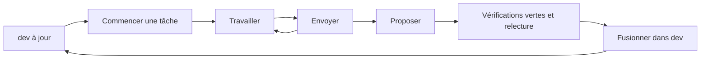

# 7. Travailler à deux : guide pas à pas

Ce guide est pour toi et ton binôme, **même sans rien connaître à Git**.
Tout se fait de trois façons, au choix :

- **la fenêtre des outils** (le plus simple) : double-clic sur **« Kadastr »** sur le Bureau, ou sur `0-ouvrir-les-outils` dans le dossier `outils/` du projet. De gros boutons, les questions une par une ;
- **double-clic** sur les fichiers numérotés du dossier `outils/` (une fenêtre noire pose les questions) ;
- **dans Claude Code** : tape une commande comme `/commencer` ou `/envoyer`.

Les trois font exactement la même chose (même moteur derrière, mêmes garde-fous). Chaque outil finit par **« Et maintenant ? »** : la prochaine étape.

**Vidéo de 3 minutes** : [medias/fenetre-des-outils.mp4](medias/fenetre-des-outils.mp4) montre la fenêtre des outils sur une journée complète, du raccourci du Bureau jusqu'à la fusion (sous-titres, sans son, sur un projet d'exemple). Dans l'Explorateur : dossier `docs/medias` du projet, double-clic sur la vidéo.

## Les mots à connaître

| Mot | Ce que ça veut dire |
|---|---|
| **Dépôt** | Le projet sur GitHub, partagé par les deux. |
| **`dev`** | La version de travail commune. On n'y travaille **jamais** directement. |
| **`main`** | La version stable, mise à jour à chaque fin d'étape. |
| **Tâche** (branche) | Ta copie de travail pour une seule chose. Ex. : `feat/api-achat-territoire`. |
| **Enregistrer** (commit) | Prendre une photo de ton travail, avec une phrase qui dit ce qui change. |
| **Envoyer** (push) | Mettre tes enregistrements sur GitHub. C'est aussi ta sauvegarde. |
| **Proposition** (pull request, PR) | Demander que ta tâche rejoigne `dev`. |
| **Vérifications** (CI) | Les tests que GitHub lance tout seul sur chaque proposition. Vert = tout passe. |
| **Relecture** | Ton binôme regarde ta proposition et l'accepte. |
| **Fusionner** | Faire entrer la proposition dans `dev`. |

## Le principe



## La fenêtre des outils

Double-clic sur **« Kadastr »** (Bureau) : une fenêtre s'ouvre.

- **En haut à gauche, « Où j'en suis »** : sur quelle tâche tu es, ce qui n'est pas encore enregistré ou envoyé, ta proposition et ses vérifications.
- **« Et maintenant ? »** : la prochaine étape conseillée, avec son bouton. Le bouton de l'étape conseillée est aussi entouré en bleu.
- **Les 5 boutons** : Mettre à jour, Commencer une tâche, Envoyer mon travail, Proposer mon travail, Fusionner.
- **À droite** : les propositions ouvertes (avec un bouton « Fusionner » quand c'est possible), tes autres tâches (bouton « Reprendre ») et la dernière vérification de `dev`.
- **Le menu « … »** : « Vérifier mon poste » et, pour le propriétaire, la fin d'étape.

Quand tu cliques sur un bouton, un panneau montre ce qui se passe et pose les questions une par une (boutons à choisir, ou une phrase à taper). « Annuler » arrête sans rien changer. À la fin, « Et maintenant ? » propose le bouton suivant.

La fenêtre ne marche que sur ton PC (personne d'autre ne peut l'ouvrir). Une petite fenêtre noire réduite dans la barre des tâches la fait tourner : ne la ferme pas, elle se ferme toute seule avec la fenêtre des outils.

## Les outils

| Double-clic (`outils/`) | Dans Claude Code | Ce que ça fait |
|---|---|---|
| `0-ouvrir-les-outils` | | Ouvre la fenêtre des outils (tous les boutons ci-dessous). |
| `1-installer-mon-poste` | | Installe Git, Node.js et GitHub CLI, te connecte à GitHub, copie le projet. Relançable sans risque. |
| `2-mettre-a-jour` | `/mettre-a-jour` | Récupère le dernier `dev`. Sur une tâche, propose d'y intégrer les nouveautés. Range les tâches déjà fusionnées. |
| `3-commencer-une-tache` | `/commencer <sujet>` | Crée ta tâche à partir du dernier `dev`. Te demande : fonctionnalité ou correction, la zone, le sujet en clair. Peut aussi reprendre une tâche commencée. |
| `4-envoyer-mon-travail` | `/envoyer` | Enregistre tout ton travail et l'envoie sur GitHub. Te demande une phrase. |
| `5-proposer-mon-travail` | `/proposer` | Ouvre la proposition vers `dev`, remplie avec le modèle du projet. |
| `6-ou-j-en-suis` | `/ou-j-en-suis` | Montre où tu en es, les propositions ouvertes, les vérifications. Ne change rien. |
| `7-fusionner` | `/fusionner [n°]` | Fusionne une proposition dont les vérifications sont vertes. |
| `8-fin-d-etape` | `/fin-d-etape` | Fin d'étape : `dev` vers `main`, puis version `v0.<étape>.0`. |
| | `/relire <n°>` | Claude t'explique la proposition de ton binôme avant que tu l'acceptes. |

## 1. Installer ton poste (une seule fois)

1. Crée un compte sur [github.com](https://github.com) si tu n'en as pas, et donne ton pseudo au propriétaire du dépôt.
2. Le propriétaire t'invite (voir [plus bas](#ajouter-le-binôme)). Tu reçois un e-mail : tu peux accepter tout de suite, ou laisser l'installateur le faire.
3. Ouvre le **Terminal** : clic droit sur le bouton Démarrer, puis « Terminal ».
4. Copie cette ligne, colle-la dans le Terminal (clic droit), puis appuie sur Entrée :

   ```powershell
   irm https://raw.githubusercontent.com/Ivar-lordbrock/france-tycoon/dev/outils/moteur/installer.ps1 | iex
   ```

5. Réponds aux questions :
   - Windows peut demander l'autorisation d'installer : clique sur **Oui** ;
   - pour GitHub : un code à 8 caractères s'affiche, une page s'ouvre, colle le code et clique sur « Authorize ».
6. À la fin, le projet est dans `C:\Users\<toi>\france-tycoon`, un raccourci **« Kadastr »** est sur le Bureau (si tu as dit oui) et la fenêtre des outils s'ouvre.
7. Pour les commandes Claude : installe [Claude](https://claude.ai/download), va dans l'onglet **Code** et ouvre le dossier du projet.

Plus tard, `1-installer-mon-poste` sert à vérifier que tout va bien : ce qui est déjà en place est seulement vérifié.

## 2. La journée type

Ouvre la fenêtre des outils (« Kadastr » sur le Bureau) et suis « Et maintenant ? ». Dans l'ordre :

1. **Mettre à jour** : tu récupères le travail de ton binôme.
2. **Commencer une tâche** : par exemple « achat de territoire », zone `api`. L'outil crée `feat/api-achat-territoire`.
3. **Tu travailles**, seul ou avec Claude.
4. **Envoyer mon travail**, souvent (au moins à chaque pause) : c'est aussi ta sauvegarde.
5. La tâche est finie : **Proposer mon travail**.
6. Regarde « Où j'en suis » : attends que les vérifications soient vertes (quelques minutes, la fenêtre se met à jour toute seule), puis que ton binôme accepte.
7. **Fusionner**, puis on recommence en 1.

Sans la fenêtre, c'est pareil avec les fichiers `2-mettre-a-jour` à `7-fusionner`.

Une tâche = **une seule chose**, petite (quelques jours au plus). Plus c'est petit, moins il y a de conflits.

## 3. Relire le travail de ton binôme

- Sa proposition apparaît dans la fenêtre des outils (« Propositions ouvertes ») et dans `6-ou-j-en-suis`, et GitHub t'envoie un e-mail.
- **Avec Claude** : `/relire 12` (le numéro de la proposition). Claude t'explique ce qui change, vérifie les règles du projet, et te demande avant d'accepter.
- **Sur GitHub** : ouvre la proposition, onglet « Files changed », bouton « Review changes », puis « Approve » (accepter) ou « Request changes » (demander des changements), et « Submit review ».
- Une fois acceptée et verte, **l'auteur** de la proposition la fusionne avec `7-fusionner`.

## 4. Tant que tu es seul

La règle « une relecture obligatoire » reste active sur `dev` et `main`.
Tant que ton binôme n'est pas là, `7-fusionner` te propose de **passer outre avec ton droit d'administrateur**, seulement si les vérifications sont vertes, et après t'avoir demandé confirmation.

Le jour où ton binôme arrive, il n'y a rien à changer : ses propositions et les tiennes passeront par la relecture. Lui n'est pas administrateur, il ne peut donc pas passer outre.

## 5. Fin d'étape (propriétaire)

Lance `8-fin-d-etape` **deux fois** :

1. la première fois, il ouvre la proposition `dev` vers `main` avec la liste de ce qui a changé ;
2. quand les vérifications sont vertes, la seconde fois il fusionne dans `main` et crée la version `v0.<étape>.0` (visible dans « Releases » sur GitHub).

## 6. Quand l'outil dit « Stop »

« Stop » veut dire qu'un garde-fou a refusé : **rien n'a été cassé**. Le message dit quoi faire (dans la fenêtre des outils, avec le bouton de l'outil à lancer).

| Message | Quoi faire |
|---|---|
| « Tu es sur dev : on n'y enregistre jamais directement » | Lance `3-commencer-une-tache` : tes modifications te suivent sur la nouvelle tâche. |
| « modifications pas encore envoyées » | Lance `4-envoyer-mon-travail`, puis recommence. |
| « Conflit » | Vous avez modifié les mêmes lignes. Tout a été remis comme avant. Dans Claude : « intègre dev dans ma tâche et règle les conflits ». |
| « Je n'envoie pas ces fichiers » | Un secret (`.env`), une base (`.sqlite`) ou un fichier de plus de 10 Mo. Sors-le du projet. |
| « GitHub refuse l'envoi » | Tu n'as pas encore accepté l'invitation : relance `1-installer-mon-poste`. |
| « vérifications ROUGES » | Un test échoue. Dans Claude : « pourquoi les vérifications de ma proposition sont rouges ? ». |
| « Node.js est introuvable » | Lance `1-installer-mon-poste`. |
| « Les outils sont fermés » (fenêtre des outils) | La petite fenêtre noire a été fermée : ferme la fenêtre et rouvre « Kadastr ». |

**Règles d'or** : ne jamais travailler directement sur `dev` ou `main` (les outils refusent), envoyer souvent, une tâche = une chose. Si tu ne comprends pas un message, copie-le à Claude.

## 7. Pour le propriétaire du dépôt

### Ajouter le binôme

1. Sur GitHub : le dépôt, puis **Settings**, **Collaborators**, **Add people**, son pseudo, rôle **Write** (pas Admin).
2. Dans `.github/CODEOWNERS`, décommenter les lignes et remplacer les pseudos d'exemple par les vrais : GitHub demandera alors la relecture à la bonne personne (Claude peut le faire : « mets à jour CODEOWNERS avec le pseudo X »).
3. Lui envoyer le lien de ce guide.

### Sous le capot

- Le moteur est `outils/moteur/duo.mjs` (Node.js). `node outils/moteur/duo.mjs aide` liste les actions et leurs options pour l'utiliser sans clavier (c'est ce que font les commandes de `.claude/commands/`).
- La fenêtre des outils (`duo.mjs interface`, fichiers `interface.mjs` et `interface.html`) est une page web locale : un petit serveur sur `127.0.0.1` seulement, un jeton secret tiré au hasard à chaque ouverture, l'adresse vérifiée, et seulement les actions de la liste. Elle s'ouvre dans Edge (ou Chrome) en mode application et s'arrête toute seule quand on la ferme. Chaque bouton lance le moteur en « mode interface » (`DUO_INTERFACE=1`) : ses messages et ses questions sortent en lignes JSON (`@@{...}`), les réponses repartent par son entrée. « Où j'en suis » vient de `duo.mjs etat --json`.
- Garde-fous : refus sur `main` et `dev`, arrêt s'il reste des modifications non enregistrées, jamais de `--force`, fusion seulement si les vérifications sont vertes, secrets et gros fichiers refusés, aucune fusion laissée à moitié en cas de conflit.
- Les fichiers `.bat` trouvent Node.js même s'il n'est pas dans le PATH (`C:\Program Files\nodejs`). Le moteur trouve Git et GitHub CLI de la même façon.
- Codes de sortie : 0 = fait, 1 = refusé par un garde-fou, 2 = il manque une réponse ou une option, 3 = erreur inattendue.
- Tests : `node --test outils/` (faux dépôts locaux). Ils tournent aussi sur Windows dans la CI « Outils du duo ».
